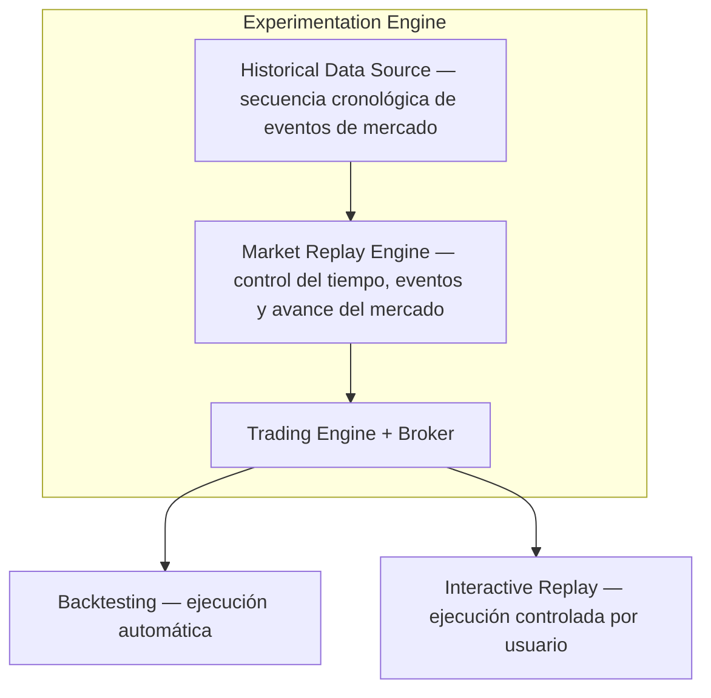
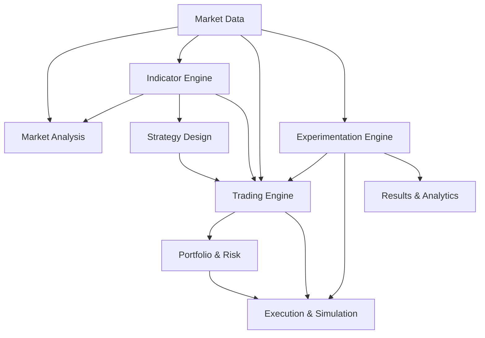

# Propuesta de arquitectura: plataforma de desarrollo y experimentación de estrategias de trading

> Fuente de verdad de requisitos y diseño. **Los números de sección (§1–§14) son la referencia
> estable** citada por el resto de `docs/`: si este documento se renumera, esas citas se rompen.
> Estado de la implementación: [`proyectstate.md`](./proyectstate.md); mapa del código:
> [`domain-diagram.md`](./domain-diagram.md); dirección del producto: [`../README.md`](../README.md).

Plantearía la aplicación como un laboratorio de trading, no simplemente como un backtester con un editor de estrategias y un visor de gráficos.

La idea central es que el usuario pueda recorrer un ciclo completo de experimentación:

1. Obtener y organizar datos históricos de mercado.
2. Analizar gráficamente los activos mediante indicadores y herramientas de análisis técnico.
3. Diseñar estrategias de trading.
4. Ejecutar backtests sobre periodos históricos.
5. Analizar los resultados y modificar las estrategias.
6. Reproducir el mercado histórico como si estuviera sucediendo en tiempo real.
7. Evaluar la estrategia sin conocer los datos futuros.
8. Comparar experimentos y evaluar su robustez.

Hay una decisión arquitectónica que considero especialmente importante: separar la definición de una estrategia de su ejecución y de los experimentos en los que participa.

Una misma estrategia debería poder ejecutarse en distintos contextos: backtesting, simulación histórica interactiva y, eventualmente, trading real.

## 1. División general en subsistemas

Propongo inicialmente ocho subsistemas principales:

1\. Market Data

Adquisición, normalización y almacenamiento de datos de mercado

2\. Market Analysis

Gráficos, indicadores y análisis técnico

3\. Strategy Design

Definición y configuración de estrategias

4\. Trading Engine

Evaluación, estados y decisiones de trading

5\. Execution & Simulation

Órdenes, posiciones, ejecución simulada y costes

6\. Experimentation Engine

Backtesting, reproducción histórica y test-forward

7\. Portfolio & Risk

Capital, exposición y gestión del riesgo

8\. Results & Analytics

Métricas, visualización y comparación de experimentos

Application Layer

Casos de uso, persistencia, coordinación y UI

No significa que deban ser ocho microservicios. Los plantearía inicialmente como módulos de un monolito modular, con dependencias explícitas y modelos de dominio independientes de React.

Vamos a ver las responsabilidades de cada uno.

## 2. Market Data — Subsistema de datos de mercado

Es la infraestructura que proporciona los datos a los demás subsistemas.

Responsabilidades:

- Obtener cotizaciones de proveedores externos.
- Importar ficheros CSV y otros formatos.
- Normalizar instrumentos y mercados.
- Almacenar series temporales.
- Consultar datos por activo, timeframe y rango temporal.
- Construir velas a partir de datos de menor granularidad.
- Detectar huecos, duplicados y datos inconsistentes.

Modelo de dominio principal:

- `Market`
- `Exchange`
- `Instrument`
- `TradingPair`
- `Candle`
- `Trade`
- `OrderBookSnapshot`
- `Timeframe`
- `MarketDataSeries`

> **Estado:** implementados `Instrument`, `Candle`, `Timeframe` y `Trade` (más el puerto
> `MarketDataProvider` en `src/api/`); `Market`, `Exchange`, `TradingPair`, `OrderBookSnapshot` y
> `MarketDataSeries` siguen siendo modelo previsto — pendientes en «Market Data completo (§2)» de
> [`proyectstate.md`](./proyectstate.md).

Una vela debería tener una semántica bien definida: timestamp de apertura, OHLCV, instrumento y timeframe.

Un aspecto importante es que los datos no deberían estar acoplados al proveedor que los proporciona.

Por ejemplo:

```
interface MarketDataProvider {
    getCandles(
        instrument: Instrument,
        timeframe: Timeframe,
        range: TimeRange
    ): Promise<Candle[]>;
}
```

La implementación puede obtener datos de Binance, otro exchange o un CSV.

Decisión: todos los subsistemas trabajan con un modelo de datos de mercado normalizado.

## 3. Market Analysis — Análisis técnico y gráficos

Este subsistema proporciona las herramientas para estudiar el comportamiento del mercado.

Lo dividiría en tres responsabilidades.

A. Charting

- Representación de velas.
- Volumen.
- Diferentes timeframes.
- Zoom y navegación temporal.
- Sincronización de varios gráficos.
- Dibujos: líneas de tendencia, soportes, resistencias, canales, etc.

B. Indicator Engine

Los indicadores son objetos que saben calcular sus valores a partir de datos de mercado.

Ejemplos:

- SMA / EMA.
- RSI.
- MACD.
- ATR.
- Bollinger Bands.
- VWAP.

Una interfaz conceptual:

```
interface Indicator {
    calculate(
        candles: Candle[]
    ): IndicatorValue[];
}
```

C. Technical Analysis

Este componente puede incorporar conceptos de mayor nivel:

- Detección de tendencias.
- Identificación de soportes y resistencias.
- Detección de patrones.
- Análisis de volatilidad.
- Estructuras de mercado.

Una distinción importante: el motor de indicadores no debería depender del gráfico. Los indicadores deben poder utilizarse tanto en una estrategia como en un análisis visual.

Por ejemplo, un RSI calculado por el sistema debería ser exactamente el mismo tanto si se muestra en el gráfico como si lo consulta una estrategia.

## 4. Strategy Design — Diseño de estrategias

Este subsistema permite definir, configurar, versionar y almacenar estrategias.

Separaría dos conceptos:

Strategy Definition

Describe qué hace una estrategia, sus reglas y parámetros.

Strategy Instance

Representa una ejecución concreta de esa estrategia, con su propio estado y ciclo de vida.

Una estrategia podría componerse de:

- Condiciones de entrada.
- Condiciones de salida.
- Indicadores utilizados.
- Gestión de posiciones.
- Stop Loss y Take Profit.
- Reglas de gestión del riesgo.
- Parámetros configurables.

Ejemplo conceptual:

```
class Strategy {
    constructor(
        private readonly entryRules: EntryRule[],
        private readonly exitRules: ExitRule[],
        private readonly indicators: Indicator[]
    ) {}

    evaluate(context: MarketContext): StrategyDecision {
        // Evaluación de las reglas
    }
}
```

No tomaría este ejemplo como una interfaz definitiva: lo importante es que la estrategia tenga comportamiento propio y no sea simplemente una colección de funciones y objetos de configuración.

Versionado

Una estrategia debe ser reproducible.

Si se modifica un parámetro o una regla, debería generarse una nueva versión de la definición.

Así podremos saber exactamente qué estrategia produjo cada resultado histórico.

## 5. Trading Engine — Motor de trading

Es el núcleo de ejecución de las estrategias.

Su responsabilidad es coordinar las estrategias activas y gestionar sus ciclos de vida.

Por ejemplo:

1. Recibir información de mercado.
2. Actualizar los indicadores.
3. Evaluar las condiciones de las estrategias.
4. Determinar las transiciones de estado.
5. Generar decisiones de trading.
6. Comunicar las decisiones al sistema de ejecución.

Aquí utilizaría objetos de dominio con estado y comportamiento.

Por ejemplo, una estrategia en ejecución podría tener estados como:

`Confirmed → Opened → Profit / Loss → Closed`

El motor no debería conocer si está ejecutándose un backtest o una simulación interactiva. Tampoco debería conocer React.

Su responsabilidad es gestionar la lógica de trading.

Una posible división interna:

- `StrategyRunner`: ciclo de ejecución de una estrategia.
- `TradingEngine`: coordinación de las estrategias en ejecución (cada experimento opera **una**
  estrategia con su propio capital; la comparación es entre experimentos).
- `IndicatorRegistry`: indicadores disponibles.
- `MarketContext`: información disponible para evaluar una estrategia.
- `StrategyDecision`: decisiones generadas por las estrategias.

Una decisión puede ser abrir una posición, cerrarla, modificar un stop o no hacer nada.

## 6. Execution & Simulation — Ejecución y simulación

Este subsistema convierte las decisiones del Trading Engine en operaciones simuladas.

Es importante separar la decisión de trading de su ejecución.

Por ejemplo, una estrategia puede decidir comprar BTC, pero eso no significa que la compra se haya ejecutado al precio esperado.

Responsabilidades:

- Gestión de órdenes.
- Ejecución de órdenes.
- Gestión de posiciones.
- Cálculo de comisiones.
- Slippage.
- Spread.
- Funding en futuros perpetuos.
- Apalancamiento y margen.
- Liquidaciones.
- Registro de operaciones ejecutadas.

Modelo conceptual:

- `Order`
- `OrderBook`
- `Execution`
- `Position`
- `Trade`
- `Broker`
- `ExecutionModel`

Definiría una abstracción `Broker` que represente el intermediario entre las decisiones de trading y el mercado.

```
interface Broker {
    submitOrder(order: Order): void;

    cancelOrder(orderId: OrderId): void;

    getPositions(): Position[];
}
```

Podríamos tener distintas implementaciones:

- `HistoricalBroker`: simula ejecuciones sobre datos históricos.
- `PaperTradingBroker`: simulación con datos de mercado recibidos en tiempo real.
- `LiveBroker`: ejecución mediante un exchange real, en una futura fase.

El `TradingEngine` no debería necesitar conocer qué implementación se está utilizando.

## 7. Experimentation Engine — Motor de experimentación

Este es uno de los subsistemas más importantes de toda la aplicación.

Su responsabilidad es ejecutar experimentos con estrategias bajo condiciones controladas.

Lo dividiría en tres componentes.

A. Backtesting

Ejecuta una estrategia sobre datos históricos.

Recibe:

- Una versión de estrategia.
- Un activo.
- Un timeframe.
- Un periodo histórico.
- Un capital inicial.
- Un modelo de ejecución.
- Una configuración de riesgo.

Produce:

- Operaciones.
- Evolución del capital.
- Drawdown.
- Rentabilidad.
- Comisiones.
- Exposición.
- Métricas de rendimiento.

B. Historical Replay

Este componente reproduce el mercado histórico como si estuviera sucediendo en tiempo real.

Es diferente del backtesting convencional.

Permite:

- Reproducir el mercado a velocidad normal.
- Aumentar o reducir la velocidad.
- Pausar y continuar.
- Avanzar vela a vela.
- Observar los indicadores.
- Observar las decisiones de las estrategias.
- Intervenir manualmente.
- Abrir y cerrar posiciones manualmente.

La característica fundamental es que la estrategia solamente puede acceder a la información disponible en el instante de reproducción.

No debe poder consultar datos futuros.

C. Test-forward

Permite ejecutar estrategias sobre datos que no han sido utilizados para diseñarlas o ajustar sus parámetros.

Por ejemplo:

- Periodo de diseño: enero-junio.
- Backtesting: enero-junio.
- Test-forward: julio-agosto.

La finalidad es comprobar si el comportamiento observado en el backtest se mantiene sobre datos nuevos.

No lo consideraría simplemente otro tipo de backtest, sino un experimento con una separación explícita entre datos de desarrollo y evaluación.

> **Estado (2026-11-14): el split dev/eval automático aquí descrito fue sustituido por el
> test-forward interactivo** (puntos de confirmación aleatorios, decisiones del usuario y overrides
> de TP/SL); `split.ts` y `testForward.ts` se eliminaron. Implementación en `src/domain/testforward/`,
> decisiones en [`estrategias-testforward-plan.md`](./estrategias-testforward-plan.md).

### Una decisión arquitectónica importante: compartir el motor de ejecución temporal

Backtesting y Historical Replay deberían compartir el mismo mecanismo fundamental de reproducción de datos.

La diferencia estaría en cómo se controla el tiempo y cómo se presenta la ejecución.



Esto evita implementar dos motores de trading diferentes, uno para backtesting y otro para simulación interactiva.

También facilita que un resultado de backtesting pueda investigarse posteriormente mediante reproducción histórica.

## 8. Portfolio & Risk — Gestión del capital y riesgo

Separaría la gestión del riesgo de la lógica de las estrategias.

Una estrategia decide qué operación quiere realizar. El subsistema de riesgo determina si esa operación es admisible teniendo en cuenta las condiciones de la cuenta.

Responsabilidades:

- Capital disponible.
- Balance y equity.
- Margen utilizado.
- Exposición por activo.
- Exposición total.
- Riesgo por operación.
- Pérdida máxima permitida.
- Drawdown máximo.
- Restricciones de apalancamiento.

Por ejemplo, una estrategia puede solicitar una entrada mientras ya existe una posición abierta
o una orden pendiente de relleno.

La gestión de riesgo evalúa esa decisión frente a la cuenta — efectivo disponible, exposición
total, reserva mínima — y determina si la operación es admisible. Cada experimento tiene su
propio capital: **no hay capital compartido entre estrategias** (la comparación es entre
experimentos).

Este subsistema debería ser independiente del mecanismo que ejecuta las órdenes.

## 9. Results & Analytics — Resultados y análisis

Es el subsistema encargado de convertir los experimentos en información útil.

No limitaría el análisis a mostrar rentabilidad.

Métricas:

- Net Profit.
- ROI.
- Maximum Drawdown.
- Sharpe Ratio.
- Sortino Ratio.
- Profit Factor.
- Win Rate.
- Average Trade.
- Expectancy.
- Tiempo medio en posición.
- Exposición al mercado.

Visualizaciones:

- Equity Curve.
- Drawdown Curve.
- Distribución de resultados.
- Histograma de operaciones.
- Operaciones sobre el gráfico de velas.
- Comparación de estrategias.
- Comparación de periodos.
- Comparación de parámetros.

También incorporaría un concepto de `Experiment`, que permita relacionar:

- Estrategia y versión.
- Parámetros utilizados.
- Dataset.
- Periodo evaluado.
- Modelo de ejecución.
- Configuración de riesgo.
- Resultados.

Así podremos reproducir un experimento y comparar sus resultados con otros.

## 10. Relaciones entre subsistemas

La siguiente es mi propuesta de dependencias. Es importante evitar que todos los subsistemas conozcan directamente a los demás.

### Arquitectura lógica



Esquema conceptual de responsabilidades, no un grafo exhaustivo de dependencias. En particular, Experimentation Engine coordina los componentes de ejecución y datos mediante sus interfaces.

Hay una precisión importante: el indicador no debería ser propiedad exclusiva de Market Analysis. Lo situaría como un componente de dominio reutilizable por Strategy Design, Trading Engine y el análisis gráfico.

Igualmente, Experimentation Engine no debería contener las reglas de trading. Su responsabilidad es organizar y controlar los experimentos.

## 11. Arquitectura de la aplicación y organización del código

Para una primera implementación utilizaría un monolito modular con dependencias explícitas y
modelos de dominio independientes de React, organizado en tres capas:

| Capa           | Responsabilidad                               |
| -------------- | --------------------------------------------- |
| Domain         | Objetos, comportamiento, reglas e invariantes |
| Application    | Casos de uso y coordinación                   |
| Infrastructure | Persistencia, proveedores, APIs y adaptadores |

> **Estado: la propuesta de carpetas no se adoptó tal cual.** La estructura real condensa el
> monolito modular en cuatro carpetas: `src/domain/` (lógica pura por paquetes: `candles`,
> `strategies`, `execution`, `portfolio`, `backtest`, `replay`, `testforward`, `trading`, `time`…),
> `src/storage/` (repositorios con `Storage` inyectado), `src/api/` (adaptadores al exchange) y
> `src/components/` (Atomic Design). En la práctica, Application vive en la coordinación de
> `src/components/` (hooks y `pages/App`). Ver «Estructura de carpetas» en
> [`AGENTS.md`](../AGENTS.md) y «Estructura de componentes» en [`proyectstate.md`](./proyectstate.md).

La UI debería actuar como cliente de los casos de uso y observar los cambios de estado de los objetos de dominio.

Por ejemplo, React no debería implementar la máquina de estados de una estrategia ni calcular si debe abrirse una posición.

Esto también permite ejecutar los tests del dominio sin montar componentes React.

## 12. Decisiones de diseño que considero fundamentales

Hay algunas cuestiones transversales que conviene resolver desde el principio.

### A. El tiempo como concepto de dominio

El tiempo es probablemente uno de los elementos más importantes de esta aplicación.

No debería ser simplemente un timestamp que acompaña a cada vela.

Necesitamos representar:

- Tiempo de mercado: cuándo sucedió un acontecimiento.
- Tiempo de simulación: hasta dónde hemos avanzado en la reproducción.
- Tiempo de ejecución: cuándo se procesó un acontecimiento.
- Resolución temporal: timeframe utilizado.

Introduciría una abstracción `MarketClock`, que permita controlar el avance temporal independientemente del reloj del sistema.

Esto es especialmente importante para poder reproducir los mismos experimentos de forma determinista.

### B. Evitar el look-ahead bias

Una estrategia nunca debe disponer de información que todavía no estaba disponible en el momento de tomar una decisión.

Por ejemplo, si estamos evaluando una estrategia al cierre de una vela de una hora, no podemos utilizar el máximo, mínimo o cierre de la siguiente vela.

También hay que definir cómo se ejecutan las órdenes dentro de una vela: al siguiente open, mediante datos de menor granularidad o utilizando un modelo de ejecución intrabar.

Esto afecta directamente a la validez de los backtests.

### C. Reproducibilidad

Un resultado no debería depender únicamente de la estrategia y sus parámetros.

También depende de:

- Datos históricos exactos.
- Versión de la estrategia.
- Indicadores y sus implementaciones.
- Configuración del broker simulado.
- Comisiones y slippage.
- Modelo de ejecución.
- Capital inicial.
- Configuración de riesgo.

Todo esto debería quedar registrado en el experimento.

### D. Eventos y observabilidad

Introduciría eventos de dominio para comunicar cambios relevantes:

- `StrategyConfirmed`
- `StrategyOpened`
- `PositionOpened`
- `OrderExecuted`
- `StopLossTriggered`
- `PositionClosed`
- `ExperimentCompleted`

Esto permitiría mantener desacoplados el motor, los gráficos y la interfaz.

Por ejemplo, cuando se ejecuta una operación, el gráfico puede recibir el evento y representar la entrada sin tener que conocer internamente cómo funciona el broker.

## 13. Orden de implementación propuesto

> **Estado (2026-11-18): las seis fases están completas.** El detalle por fase vive en
> [`proyectstate.md`](./proyectstate.md) y los desgloses de tareas en `fase3-plan.md` …
> `fase6-plan.md`, `ui-plan.md`, `estrategias-testforward-plan.md` y `strategy-preview-plan.md`.
> Este orden se conserva como roadmap histórico.

No intentaría implementar todos los subsistemas simultáneamente. Los organizaría en fases que permitan obtener un sistema funcional desde bastante pronto.

1. Fase 1 — Datos y gráficos
   - Importación de CSV.
   - Modelo de instrumentos y velas.
   - Almacenamiento y consultas.
   - Gráficos de velas.
   - Indicadores básicos.
     Primer resultado funcional

   Visualizar un activo y estudiar su comportamiento histórico.

2. Fase 2 — Dominio de estrategias
   - Strategy Definition.
   - Indicadores reutilizables.
   - Reglas de entrada y salida.
   - Estados de las estrategias.
   - Evaluación mediante tests.
     Resultado: definir y evaluar estrategias sin necesidad todavía de ejecutar operaciones.
3. Fase 3 — Ejecución simulada
   - Órdenes.
   - Posiciones.
   - Broker simulado.
   - Comisiones.
   - Gestión del capital.
   - Riesgo básico.
     Resultado: una estrategia puede generar operaciones y gestionar posiciones.
4. Fase 4 — Backtesting
   - Market Replay Engine.
   - Control del tiempo.
   - Ejecución automática.
   - Registro de operaciones.
   - Cálculo de métricas.
     Resultado: ejecutar un experimento completo sobre datos históricos.
5. Fase 5 — Simulación interactiva
   - Reproducción controlada por el usuario.
   - Velocidad variable.
   - Pausa y avance paso a paso.
   - Visualización de decisiones y operaciones.
   - Operaciones manuales.
     Resultado: investigar el comportamiento de una estrategia observando cómo evoluciona el mercado.
6. Fase 6 — Experimentación avanzada
   - Test-forward.
   - Comparación de estrategias.
   - Optimización de parámetros.
   - Análisis de robustez.
   - Comparación de activos y timeframes.
   - Un experimento = una estrategia + su propio capital; la comparación es entre experimentos.
     Resultado: un laboratorio para desarrollar y validar sistemas de trading.

## 14. Mi propuesta de límites arquitectónicos

Hay tres subsistemas que considero especialmente importantes y que protegería de dependencias externas:

| Subsistema      | Debe desconocer                              |
| --------------- | -------------------------------------------- |
| Strategy Design | React, exchanges y mecanismos de ejecución   |
| Trading Engine  | Backtesting, interfaz y proveedores de datos |
| Execution       | Reglas internas de las estrategias           |

Y hay un cuarto componente que merece un tratamiento especial:

Experimentation Engine no debe implementar otro Trading Engine. Debe utilizar el existente y proporcionar el contexto temporal y de ejecución necesario.

Esta separación permitirá incorporar nuevas modalidades de experimentación sin duplicar las reglas de negocio.
