# Diagrama de clases del dominio (Fase 3)

> Diagramas Mermaid de `src/domain/` tras completar la **Fase 3 — Ejecución simulada**
> (2026-11-11). Fuente de verdad del código: los propios archivos; requisitos: [`AGENTS.md`](../AGENTS.md).
> Convenciones al final del documento.

## 1. Modelo de dominio

```mermaid
classDiagram
    namespace candles {
        class Candle {
            <<valueObject>>
            +time: number
            +open: number
            +high: number
            +low: number
            +close: number
            +volume: number
            +from(value) Candle
            +aggregate(group, timeframe) Candle
            +positionOf(price) PricePosition
        }
        class Timeframe {
            <<interned>>
            +code: TimeframeCode
            +ms: number
            +from(value) Timeframe
            +equals(other) Timeframe
        }
        class PricePosition {
            <<enumeration>>
            Above
            UpperWick
            Body
            LowerWick
            Below
        }
        class LevelPosition {
            <<enumeration>>
            Above
            At
            Below
        }
        class CsvCandlesImporter {
            +parse(text: string) Candle[]
            +parseRow(row: string) Candle
            +detectDelimiter(text: string) CsvDelimiter
        }
    }

    namespace instruments {
        class Instrument {
            <<interned>>
            +base: string
            +quote: string
            +from(value) Instrument
            +of(base, quote) Instrument
            +exchangeSymbol: string
            +equals(other: Instrument) boolean
        }
    }

    namespace indicators {
        class IndicatorValue {
            +time: number
            +value: number
        }
        class Indicator {
            <<interface>>
            +name: string
            +calculate(candles: Candle[]) IndicatorValue[]
        }
        class Sma {
            +period: number
            +calculate(candles: Candle[]) IndicatorValue[]
        }
        class Ema {
            +period: number
            +calculate(candles: Candle[]) IndicatorValue[]
        }
        class Rsi {
            +period: number
            +calculate(candles: Candle[]) IndicatorValue[]
        }
    }

    namespace strategies {
        class MarketContext {
            <<inmutable>>
            -visibleCandles: Candle[]
            -series: Map
            +from(data) MarketContext
            +time: number
            +current: Candle
            +previous: Candle
            +length: number
            +candles: Candle[]
            +value(id: string, back: number) number
        }
        class Rule {
            <<interface>>
            +name: string
            +evaluate(context: MarketContext) boolean
        }
        class Crosses {
            +a: SeriesRef
            +b: SeriesRef
            -direction: string
            +evaluate(context: MarketContext) boolean
        }
        class CrossesAbove
        class CrossesBelow
        class Comparison {
            +a: SeriesRef
            +b: SeriesRef
            -op: string
            +evaluate(context: MarketContext) boolean
        }
        class Greater
        class Lower
        class Logical {
            +rules: Rule[]
            -mode: string
            +evaluate(context: MarketContext) boolean
        }
        class All
        class Any
        class Not {
            +rule: Rule
            +evaluate(context: MarketContext) boolean
        }
        class Signal {
            +name: string
            +action: SignalAction
            +rule: Rule
            +config: SignalConfig
        }
        class SignalConfig {
            +fraction: number
            +limitPrice: SeriesRef
        }
        class Strategy {
            +name: string
            +version: number
            +indicators: Map
            +signals: Signal[]
            +invalidationRule: Rule
            +buildContext(candles: Candle[]) MarketContext
            +evaluate(context: MarketContext, open: boolean) StrategyDecision
            +toString() string
        }
        class StrategyDecision {
            <<interface>>
            +action: StrategyAction
            +fraction: number
            +price: number
            +reason: string
        }
        class StrategyAction {
            <<enumeration>>
            None
            RequestEntry
            RequestAdd
            RequestReduce
            RequestExit
            Invalidate
        }
        class StrategyState {
            <<enumeration>>
            WaitingForSignal
            WaitingForEntryFill
            WaitingForExitSignal
            WaitingForExitFill
        }
        class StrategyEvent {
            <<union>>
            StrategyConfirmed
            EntryCancelled
            PositionOpened
            ExitRequested
            PositionClosed
        }
        class StrategyTransition {
            <<interface>>
            +from: StrategyState
            +to: StrategyState
            +changed: boolean
            +event: StrategyEvent
        }
        class StrategyInstance {
            +strategy: Strategy
            -current: StrategyState
            +state: StrategyState
            +open: boolean
            +entryPending: boolean
            +apply(decision: StrategyDecision) StrategyTransition
            +onFill() StrategyTransition
        }
    }

    namespace execution {
        class Order {
            +id: string
            +side: OrderSide
            +type: OrderType
            +qty: number
            +price: number
            +createdAt: number
            +rejectReason: string
            +status: OrderStatus
            +isPending: boolean
            +fill()
            +cancel()
            +reject(reason: string)
        }
        class OrderSide {
            <<enumeration>>
            Buy
            Sell
        }
        class OrderType {
            <<enumeration>>
            Market
            Limit
        }
        class OrderStatus {
            <<enumeration>>
            Pending
            Filled
            Cancelled
            Rejected
        }
        class Fill {
            +orderId: string
            +side: OrderSide
            +price: number
            +qty: number
            +fee: number
            +time: number
        }
        class ExecutionModel {
            <<interface>>
            +evaluate(order: Order, candle: Candle) Fill
        }
        class NextOpenExecutionModel {
            +slippageBps: number
            +feeBps: number
            +evaluate(order: Order, candle: Candle) Fill
        }
        class Position {
            +openedAt: number
            -qtyValue: number
            -entryPrice: number
            -realized: number
            -fees: number
            +qty: number
            +avgEntryPrice: number
            +realizedPnl: number
            +feesPaid: number
            +isOpen: boolean
            +isEmpty: boolean
            +from(fill: Fill) Position
            +applyFill(fill: Fill)
            +marketValue(price: number) number
            +unrealizedPnl(price: number) number
        }
        class Broker {
            <<interface>>
            +submitOrder(order: Order) Order
            +cancelOrder(orderId: string)
            +advance(candle: Candle) Fill[]
            +positions() Position[]
            +pendingOrders() Order[]
        }
        class HistoricalBroker {
            +portfolio: Portfolio
            +executionModel: ExecutionModel
            -pending: Order[]
            +submitOrder(order: Order) Order
            +cancelOrder(orderId: string)
            +advance(candle: Candle) Fill[]
            +positions() Position[]
            +pendingOrders() Order[]
        }
    }

    namespace portfolio {
        class Portfolio {
            +initialCapital: number
            -cashValue: number
            -positionValue: Position
            -closedRealized: number
            -fees: number
            +cash: number
            +position: Position
            +realizedPnl: number
            +feesPaid: number
            +exposure(price: number) number
            +equity(price: number) number
            +applyFill(fill: Fill)
        }
        class RiskConfig {
            <<interface>>
            +maxPositionFraction: number
            +minCashReserve: number
            +feeBps: number
            +slippageBps: number
        }
        class RiskManager {
            +maxPositionFraction: number
            +minCashReserve: number
            +feeBps: number
            +slippageBps: number
            +entryQty(portfolio: Portfolio, price: number) number
            +addQty(portfolio: Portfolio, price: number, fraction: number) number
            +canAdd(portfolio: Portfolio, price: number, qty: number) boolean
        }
    }

    namespace trading {
        class StrategyRunner {
            +strategy: Strategy
            +instance: StrategyInstance
            +broker: Broker
            +portfolio: Portfolio
            +risk: RiskManager
            -pendingOrder: Order
            -pendingKind: string
            -orderSeq: number
            -lastTime: number
            +onCandle(candles: Candle[]) ExecutionEvent[]
        }
        class ExecutionEvent {
            <<union>>
            StrategyEvent
            OrderSubmitted
            OrderFilled
            OrderRejected
            OrderCancelled
        }
    }

    %% candles
    Candle ..> Timeframe : aggregate
    Candle ..> PricePosition : positionOf
    CsvCandlesImporter ..> Candle : parsea

    %% indicators
    Indicator ..> Candle : entrada
    Indicator ..> IndicatorValue : salida
    Indicator <|.. Sma
    Indicator <|.. Ema
    Indicator <|.. Rsi

    %% strategies
    MarketContext --> Candle : visibles
    MarketContext ..> IndicatorValue : series
    Rule ..> MarketContext : evaluate
    Rule <|.. Crosses
    Rule <|.. Comparison
    Rule <|.. Logical
    Rule <|.. Not
    Crosses <|-- CrossesAbove
    Crosses <|-- CrossesBelow
    Comparison <|-- Greater
    Comparison <|-- Lower
    Logical <|-- All
    Logical <|-- Any
    Not --> Rule : negada
    Logical --> Rule : composición AND/OR
    Signal --> Rule : condición
    Signal ..> StrategyAction : acción
    Strategy --> Signal : señales priorizadas
    Strategy --> Indicator : declarados
    Strategy ..> MarketContext : buildContext
    Strategy ..> StrategyDecision : evaluate
    StrategyInstance --> Strategy
    StrategyInstance ..> StrategyState : máquina
    StrategyInstance ..> StrategyTransition : produce
    StrategyTransition ..> StrategyEvent
    StrategyDecision ..> StrategyAction

    %% execution
    Order ..> OrderSide
    Order ..> OrderType
    Order ..> OrderStatus
    Fill ..> OrderSide
    ExecutionModel ..> Fill : devuelve
    ExecutionModel <|.. NextOpenExecutionModel
    Position --> Fill : applyFill
    Broker ..> Order
    Broker ..> Fill
    Broker ..> Position
    Broker ..> Candle : avance
    HistoricalBroker ..|> Broker : implementa
    HistoricalBroker --> Portfolio : efectivo y posición
    HistoricalBroker --> ExecutionModel : inyectado

    %% portfolio
    Portfolio --> Position
    Portfolio ..> Fill : applyFill
    RiskManager ..> Portfolio : sizing y límites
    RiskManager ..> RiskConfig : configuración

    %% trading
    StrategyRunner --> Strategy
    StrategyRunner --> StrategyInstance
    StrategyRunner --> Broker
    StrategyRunner --> Portfolio
    StrategyRunner --> RiskManager
    StrategyRunner ..> ExecutionEvent : devuelve por vela
```



### Flujo de ejecución (cómo se relacionan los paquetes)

```
Candle ──► StrategyRunner.onCandle ──1► Broker.advance (rellenos de órdenes previas)
                    │                          │
                    │                          ▼
                    │                 Portfolio.applyFill ──► Position
                    │                          │
                    ▼                          ▼
        Strategy.buildContext/evaluate   StrategyInstance.onFill (eventos)
                    │
                    ▼
     decisión ► RiskManager (tamaño) ► Order ► Broker.submitOrder  (se rellena en la vela N+1)
```

**Invariante anti look-ahead:** dentro de `onCandle`, `advance` (rellenos) ocurre **antes** de
`evaluate` (decisión) y el envío **después**; una orden decidida en la vela N solo rellena en N+1.

## 2. Jerarquía de errores

Todos los errores de dominio extienden `DomainError` (`src/domain/errors.ts`), fijan `this.name` y

```mermaid
classDiagram
    class DomainError {
        <<abstract>>
        +name: string
        +message: string
    }
    class InvalidCandlesError
    class InvalidTimeframeError
    class InvalidCsvError
    class InvalidPriceError
    class InvalidInstrumentError
    class InvalidPeriodError
    class MarketContextError
    class InvalidStrategyDefinitionError
    class InvalidStrategyTransitionError
    class InvalidOrderError
    class InvalidFillError
    class InvalidPositionError
    class InvalidExecutionModelError
    class InvalidPortfolioError
    class InvalidRiskError

    DomainError <|-- InvalidCandlesError
    DomainError <|-- InvalidTimeframeError
    DomainError <|-- InvalidCsvError
    DomainError <|-- InvalidPriceError
    DomainError <|-- InvalidInstrumentError
    DomainError <|-- InvalidPeriodError
    DomainError <|-- MarketContextError
    DomainError <|-- InvalidStrategyDefinitionError
    DomainError <|-- InvalidStrategyTransitionError
    DomainError <|-- InvalidOrderError
    DomainError <|-- InvalidFillError
    DomainError <|-- InvalidPositionError
    DomainError <|-- InvalidExecutionModelError
    DomainError <|-- InvalidPortfolioError
    DomainError <|-- InvalidRiskError
```

formatean el mensaje con `invalidMessage(prefix, reason, raw)` (`"… (recibido: <valor>)"`).



## 3. Funciones libres y tipos no dibujados

No son clases, pero viven en `src/domain/`:

| Archivo                    | Exporta                                                             |
| -------------------------- | ------------------------------------------------------------------- |
| `errors.ts`                | `formatValue(value)`, `invalidMessage(prefix, reason, raw)`         |
| `candles/aggregate.ts`     | `aggregateCandles(candles, timeframe)`                              |
| `candles/normalize.ts`     | `normalizeCandles(raw)` — deduplica y ordena (`Candle.from` valida) |
| `candles/pricePosition.ts` | `assertFinitePrice(price)`                                          |
| `indicators/indicator.ts`  | `assertPeriod(period)`, `sortedByTime(candles)`                     |
| `strategies/rules.ts`      | `resolveRef(context, ref, back)` — alias de serie o constante       |

Tipos (alias/DTO de construcción): `CandleFields`, `TimeframeCode`, `CsvDelimiter`,
`CsvTimestampFormat`, `CsvColumnRef`, `CsvCandlesImporterOptions`, `SeriesRef`, `SignalAction`,
`MarketContextData`, `StrategyDefinition`, `OrderData`, `FillData`, `ExecutionModelConfig`.

## 4. Convenciones del diagrama

- **Visibilidad**: `+` público, `-` privado. Los `getters` se dibujan como campos (`state`, `cash`…).
- **Constructores estáticos** (`from`, `of`, `parse`, `detectDelimiter`) y `static` en general se
  muestran como métodos ordinarios.
- **Valores anulables** se escriben sin `|` (Mermaid no admite pipes en miembros); son `null` cuando
  el código lo indica: `Order.price`, `StrategyDecision.fraction/price/reason`,
  `IndicatorValue.value` (calentamiento), `Portfolio.position`, `Strategy.invalidationRule`,
  `RiskManager.entryQty/addQty` (devuelven `number | null`).
- `<<union>>` marca tipos de unión (`StrategyEvent`, `ExecutionEvent`); `<<enumeration>>` enums;
  `<<interned>>` value objects con caché (`Instrument`, `Timeframe`).
- La jerarquía de errores va aparte (sección 2) para no saturar el modelo.
