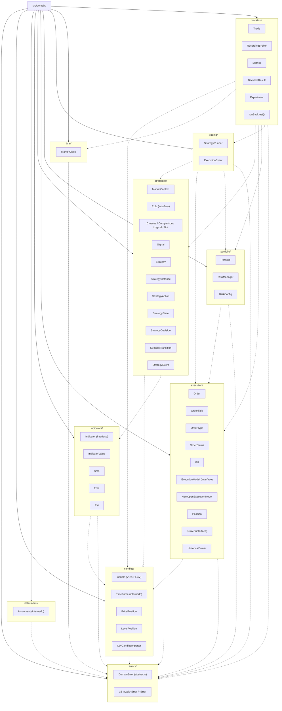
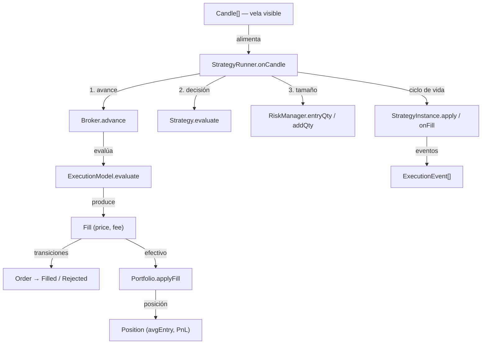

# Diagrama de clases del dominio (Fase 3)

> Diagramas Mermaid de `src/domain/` tras completar las **Fases 3 (Ejecución simulada) y 4
> (Backtesting)** (2026-11-11). Fuente de verdad del código: los propios archivos; requisitos:
> [`AGENTS.md`](../AGENTS.md).
>
> **Todos los diagramas están organizados de arriba abajo como árboles jerárquicos** (`direction TB` /
> `flowchart TB`): raíz arriba, subsistemas debajo, tipos hoja al final. El diagrama de paquetes
> muestra además las dependencias **entre** paquetes con flechas discontinuas (de quien importa a
> quien se importa), que se detallan en su tabla; el flujo de ejecución va en árbol (sección 4).

## 1. Diagrama de paquetes

Mermaid no incluye `packageDiagram` (es de PlantUML); se representa con `flowchart TB` + `subgraph`:
raíz `src/domain/` → 10 paquetes → tipos de cada paquete.

- **Sólida** `──►` = pertenencia (`src/domain/` → paquete).
- **Discontinua** `- -►` = dependencia de importación (paquete → paquete del que importa).
- Capas que emergen de arriba abajo: `backtest` → `trading` → `strategies`/`portfolio` →
  `execution`/`indicators` → `candles`/`instruments`/`time` → `errors` (raíz de errores, abajo del
  todo).
- **Sin ciclos**: `execution` **no** importa de `portfolio` gracias al puerto
  `Account` (`src/domain/execution/account.ts`): `HistoricalBroker` depende de la interfaz y
  `Portfolio` la implementa (`portfolio → execution`, un solo sentido).

### Detalle de las dependencias (las mismas flechas discontinuas del diagrama)

| Paquete       | Importa de                                                                     | Nota                                                     |
| ------------- | ------------------------------------------------------------------------------ | -------------------------------------------------------- |
| `errors`      | —                                                                              | raíz de la jerarquía de errores                          |
| `candles`     | `errors`                                                                       |                                                          |
| `instruments` | `errors`                                                                       |                                                          |
| `indicators`  | `candles`, `errors`                                                            |                                                          |
| `strategies`  | `candles`, `indicators`, `errors`                                              |                                                          |
| `execution`   | `candles`, `errors`                                                            | usa el puerto `Account` (sin dependencia de `portfolio`) |
| `portfolio`   | `execution`, `errors`                                                          | `Position`/`Fill`/`OrderSide` de `execution`             |
| `trading`     | `strategies`, `execution`, `portfolio`, `errors`                               | orquestador del runner                                   |
| `time`        | `errors`                                                                       | tiempo de simulación (§12A)                              |
| `backtest`    | `candles`, `strategies`, `execution`, `portfolio`, `trading`, `time`, `errors` | motor + `Experiment` (§7/§9)                             |

> El ciclo histórico `execution ↔ portfolio` se resolvió con el puerto `Account`
> (`src/domain/execution/account.ts`): `HistoricalBroker` depende de la interfaz y `Portfolio` la
> implementa, así que la dependencia queda en un solo sentido `portfolio → execution`.

## 2. Diagrama de clases

Jerarquía de arriba abajo: herencia (`<|--`) de padre a hijos, composición dentro de cada paquete y
solo las asociaciones de objeto entre subsistemas (el grafo fino de tipos ya se ve en los miembros).

```mermaid
classDiagram
    direction TB

    namespace candles {
        class Candle {
            <<valueObject>>
            +time: number
            +open: number
            +high: number
            +low: number
            +close: number
            +volume: number
            +from(value) Candle
            +aggregate(group, timeframe) Candle
            +positionOf(price) PricePosition
        }
        class Timeframe {
            <<interned>>
            +code: TimeframeCode
            +ms: number
            +from(value) Timeframe
            +equals(other: Timeframe) boolean
        }
        class PricePosition {
            <<enumeration>>
            Above
            UpperWick
            Body
            LowerWick
            Below
        }
        class LevelPosition {
            <<enumeration>>
            Above
            At
            Below
        }
        class CsvCandlesImporter {
            +parse(text: string) Candle[]
            +parseRow(row: string) Candle
            +detectDelimiter(text: string) CsvDelimiter
        }
    }

    namespace instruments {
        class Instrument {
            <<interned>>
            +base: string
            +quote: string
            +from(value) Instrument
            +of(base, quote) Instrument
            +exchangeSymbol: string
            +equals(other: Instrument) boolean
        }
    }

    namespace indicators {
        class IndicatorValue {
            +time: number
            +value: number
        }
        class Indicator {
            <<interface>>
            +name: string
            +calculate(candles: Candle[]) IndicatorValue[]
        }
        class Sma {
            +period: number
            +calculate(candles: Candle[]) IndicatorValue[]
        }
        class Ema {
            +period: number
            +calculate(candles: Candle[]) IndicatorValue[]
        }
        class Rsi {
            +period: number
            +calculate(candles: Candle[]) IndicatorValue[]
        }
    }

    namespace strategies {
        class MarketContext {
            <<inmutable>>
            -visibleCandles: Candle[]
            -series: Map
            +from(data) MarketContext
            +time: number
            +current: Candle
            +previous: Candle
            +length: number
            +candles: Candle[]
            +value(id: string, back: number) number
        }
        class Rule {
            <<interface>>
            +name: string
            +evaluate(context: MarketContext) boolean
        }
        class Crosses {
            +a: SeriesRef
            +b: SeriesRef
            -direction: string
            +evaluate(context: MarketContext) boolean
        }
        class CrossesAbove
        class CrossesBelow
        class Comparison {
            +a: SeriesRef
            +b: SeriesRef
            -op: string
            +evaluate(context: MarketContext) boolean
        }
        class Greater
        class Lower
        class Logical {
            +rules: Rule[]
            -mode: string
            +evaluate(context: MarketContext) boolean
        }
        class All
        class Any
        class Not {
            +rule: Rule
            +evaluate(context: MarketContext) boolean
        }
        class Signal {
            +name: string
            +action: SignalAction
            +rule: Rule
            +config: SignalConfig
        }
        class SignalConfig {
            +fraction: number
            +limitPrice: SeriesRef
        }
        class Strategy {
            +name: string
            +version: number
            +indicators: Map
            +signals: Signal[]
            +invalidationRule: Rule
            +buildContext(candles: Candle[]) MarketContext
            +evaluate(context: MarketContext, open: boolean) StrategyDecision
            +toString() string
        }
        class StrategyDecision {
            <<interface>>
            +action: StrategyAction
            +fraction: number
            +price: number
            +reason: string
        }
        class StrategyAction {
            <<enumeration>>
            None
            RequestEntry
            RequestAdd
            RequestReduce
            RequestExit
            Invalidate
        }
        class StrategyState {
            <<enumeration>>
            WaitingForSignal
            WaitingForEntryFill
            WaitingForExitSignal
            WaitingForExitFill
        }
        class StrategyEvent {
            <<union>>
            StrategyConfirmed
            EntryCancelled
            PositionOpened
            ExitRequested
            PositionClosed
        }
        class StrategyTransition {
            <<interface>>
            +from: StrategyState
            +to: StrategyState
            +changed: boolean
            +event: StrategyEvent
        }
        class StrategyInstance {
            +strategy: Strategy
            -current: StrategyState
            +state: StrategyState
            +open: boolean
            +entryPending: boolean
            +apply(decision: StrategyDecision) StrategyTransition
            +onFill() StrategyTransition
        }
    }

    namespace execution {
        class Order {
            +id: string
            +side: OrderSide
            +type: OrderType
            +qty: number
            +price: number
            +createdAt: number
            +rejectReason: string
            +status: OrderStatus
            +isPending: boolean
            +fill()
            +cancel()
            +reject(reason: string)
        }
        class OrderSide {
            <<enumeration>>
            Buy
            Sell
        }
        class OrderType {
            <<enumeration>>
            Market
            Limit
        }
        class OrderStatus {
            <<enumeration>>
            Pending
            Filled
            Cancelled
            Rejected
        }
        class Fill {
            +orderId: string
            +side: OrderSide
            +price: number
            +qty: number
            +fee: number
            +time: number
        }
        class ExecutionModel {
            <<interface>>
            +evaluate(order: Order, candle: Candle) Fill
        }
        class NextOpenExecutionModel {
            +slippageBps: number
            +feeBps: number
            +evaluate(order: Order, candle: Candle) Fill
        }
        class Position {
            +openedAt: number
            -qtyValue: number
            -entryPrice: number
            -realized: number
            -fees: number
            +qty: number
            +avgEntryPrice: number
            +realizedPnl: number
            +feesPaid: number
            +isOpen: boolean
            +isEmpty: boolean
            +from(fill: Fill) Position
            +applyFill(fill: Fill)
            +marketValue(price: number) number
            +unrealizedPnl(price: number) number
        }
        class Account {
            <<interface>>
            +cash: number
            +position: Position
            +applyFill(fill: Fill)
        }
        class Broker {
            <<interface>>
            +submitOrder(order: Order) Order
            +cancelOrder(orderId: string)
            +advance(candle: Candle) Fill[]
            +positions() Position[]
            +pendingOrders() Order[]
        }
        class HistoricalBroker {
            +account: Account
            +executionModel: ExecutionModel
            -pending: Order[]
            +submitOrder(order: Order) Order
            +cancelOrder(orderId: string)
            +advance(candle: Candle) Fill[]
            +positions() Position[]
            +pendingOrders() Order[]
        }
    }

    namespace portfolio {
        class Portfolio {
            +initialCapital: number
            -cashValue: number
            -positionValue: Position
            -closedRealized: number
            -fees: number
            +cash: number
            +position: Position
            +realizedPnl: number
            +feesPaid: number
            +exposure(price: number) number
            +equity(price: number) number
            +applyFill(fill: Fill)
        }
        class RiskConfig {
            <<interface>>
            +maxPositionFraction: number
            +minCashReserve: number
            +feeBps: number
            +slippageBps: number
        }
        class RiskManager {
            +maxPositionFraction: number
            +minCashReserve: number
            +feeBps: number
            +slippageBps: number
            +entryQty(portfolio: Portfolio, price: number) number
            +addQty(portfolio: Portfolio, price: number, fraction: number) number
            +canAdd(portfolio: Portfolio, price: number, qty: number) boolean
        }
    }

    namespace trading {
        class StrategyRunner {
            +strategy: Strategy
            +instance: StrategyInstance
            +broker: Broker
            +portfolio: Portfolio
            +risk: RiskManager
            -pendingOrder: Order
            -pendingKind: string
            -orderSeq: number
            -lastTime: number
            +onCandle(candles: Candle[]) ExecutionEvent[]
        }
        class ExecutionEvent {
            <<union>>
            StrategyEvent
            OrderSubmitted
            OrderFilled
            OrderRejected
            OrderCancelled
        }
    }

    namespace time {
        class MarketClock {
            -current: number
            +now: number
            +advanceTo(time: number)
        }
    }

    namespace backtest {
        class Trade {
            +entryTime: number
            +entryPrice: number
            +exitTime: number
            +exitPrice: number
            +qty: number
            +pnl: number
            +fees: number
            +win: boolean
            +durationMs: number
        }
        class RecordingBroker {
            +account: Account
            -tradeLog: Trade[]
            -orderLog: Order[]
            +trades: Trade[]
            +orders: Order[]
            +advance(candle: Candle) Fill[]
        }
        class Metrics {
            <<interface>>
            +netProfit: number
            +roi: number
            +maxDrawdown: number
            +sharpe: number
            +profitFactor: number
            +winRate: number
            +avgTrade: number
            +expectancy: number
        }
        class EquityPoint {
            <<interface>>
            +time: number
            +equity: number
        }
        class BacktestResult {
            <<interface>>
            +trades: Trade[]
            +equityCurve: EquityPoint[]
            +metrics: Metrics
            +finalEquity: number
            +orders: Order[]
            +events: ExecutionEvent[]
        }
        class Experiment {
            +strategyId: string
            +timeframe: Timeframe
            +period: object
            +initialCapital: number
            +execution: object
            +risk: object
            +result: BacktestResult
            +run(config) Experiment
        }
        class runBacktest {
            <<function>>
            +runBacktest(config) BacktestResult
        }
    }

    %% ---- herencia (árboles) ----
    Indicator <|.. Sma
    Indicator <|.. Ema
    Indicator <|.. Rsi
    Rule <|.. Crosses
    Rule <|.. Comparison
    Rule <|.. Logical
    Rule <|.. Not
    Crosses <|-- CrossesAbove
    Crosses <|-- CrossesBelow
    Comparison <|-- Greater
    Comparison <|-- Lower
    Logical <|-- All
    Logical <|-- Any
    HistoricalBroker ..|> Broker : implementa
    RecordingBroker ..|> Broker : implementa

    %% ---- composición por subsistema ----
    MarketContext --> Candle : velas visibles
    Logical --> Rule : AND / OR
    Not --> Rule : negada
    Signal --> Rule : condición
    Strategy --> Signal : señales priorizadas
    Strategy --> Indicator : indicadores declarados
    Strategy ..> MarketContext : buildContext
    Strategy ..> StrategyDecision : evaluate
    StrategyInstance --> Strategy
    Position --> Fill
    Portfolio --> Position
    RiskManager ..> RiskConfig
    RecordingBroker --> Account
    RecordingBroker ..> Trade : registra cierres
    RecordingBroker ..> Order : registra órdenes
    Experiment ..> BacktestResult : resultado
    Experiment ..> runBacktest : ejecuta
    runBacktest ..> BacktestResult : produce
    BacktestResult --> Metrics
    BacktestResult --> Trade

    %% ---- grafo de objetos entre subsistemas ----
    HistoricalBroker ..> Account : puerto (sin ciclo)
    Portfolio ..|> Account : implements
    HistoricalBroker --> ExecutionModel : modelo inyectado
    StrategyRunner --> Strategy
    StrategyRunner --> StrategyInstance
    StrategyRunner --> Broker
    StrategyRunner --> Portfolio
    StrategyRunner --> RiskManager
    runBacktest ..> StrategyRunner : ensambla el stack
    runBacktest ..> MarketClock : tiempo de simulación (§12A)
```

## 3. Jerarquía de errores

Todos los errores de dominio extienden `DomainError` (`src/domain/errors.ts`), fijan `this.name` y
formatean el mensaje con `invalidMessage(prefix, reason, raw)` (`"… (recibido: <valor>)"`).

## 4. Flujo de ejecución (árbol de arriba abajo)

**Invariante anti look-ahead:** dentro de `onCandle`, el **1. avance** (rellenos de órdenes previas)
ocurre antes de la **2. decisión** (cierre de la vela actual) y el envío después; una orden decidida
en la vela N solo puede rellenar en N+1 o después.

## 5. Funciones libres y tipos no dibujados

No son clases, pero viven en `src/domain/`:

| Archivo                    | Exporta                                                     |
| -------------------------- | ----------------------------------------------------------- |
| `errors.ts`                | `formatValue(value)`, `invalidMessage(prefix, reason, raw)` |
| `candles/aggregate.ts`     | `aggregateCandles(candles, timeframe)`                      |
| `candles/normalize.ts`     | `normalizeCandles(raw)` — deduplica y ordena                |
| `candles/pricePosition.ts` | `assertFinitePrice(price)`                                  |
| `indicators/indicator.ts`  | `assertPeriod(period)`, `sortedByTime(candles)`             |
| `strategies/rules.ts`      | `resolveRef(context, ref, back)` — alias o constante        |

Tipos (alias/DTO de construcción): `CandleFields`, `TimeframeCode`, `CsvDelimiter`,
`CsvTimestampFormat`, `CsvColumnRef`, `CsvCandlesImporterOptions`, `SeriesRef`, `SignalAction`,
`MarketContextData`, `StrategyDefinition`, `OrderData`, `FillData`, `ExecutionModelConfig`.

## 6. Convenciones del diagrama

- **Jerarquía vertical**: todos los diagramas usan `direction TB`/`flowchart TB` — raíz arriba,
  hijos debajo (herencia de padre a hijos, flujo de datos hacia abajo).
- **Visibilidad**: `+` público, `-` privado. Los `getters` se dibujan como campos (`state`, `cash`…).
- **Constructores estáticos** (`from`, `of`, `parse`, `detectDelimiter`) se muestran como métodos
  ordinarios.
- **Valores anulables** se escriben sin `|` (Mermaid no admite pipes en miembros); son `null` cuando
  el código lo indica: `Order.price`, `StrategyDecision.fraction/price/reason`,
  `IndicatorValue.value` (calentamiento), `Portfolio.position`, `Strategy.invalidationRule`,
  `RiskManager.entryQty/addQty` (devuelven `number | null`), `MarketClock.now` (antes del primer
  avance) y todos los campos `null`-ables de `Metrics` (`sharpe`, `profitFactor`, `winRate`,
  `avgTrade`, `expectancy` → se muestran como "—").
- `<<union>>` marca tipos de unión (`StrategyEvent`, `ExecutionEvent`); `<<enumeration>>` enums;
  `<<interned>>` value objects con caché (`Instrument`, `Timeframe`); `<<valueObject>>` VO inmutable;
  `<<function>>` funciones de caso de uso (`runBacktest`).
- El diagrama de paquetes distingue **pertenencia** (sólida, raíz → paquete) de **dependencia de
  importación** (discontinua, paquete → paquete); no hay ciclos (el `execution ↔ portfolio` quedó
  eliminado con el puerto `Account`). La jerarquía de errores va aparte (sección 3).
- Verificado con el parser real de Mermaid 11 (`mermaid.parse`).
