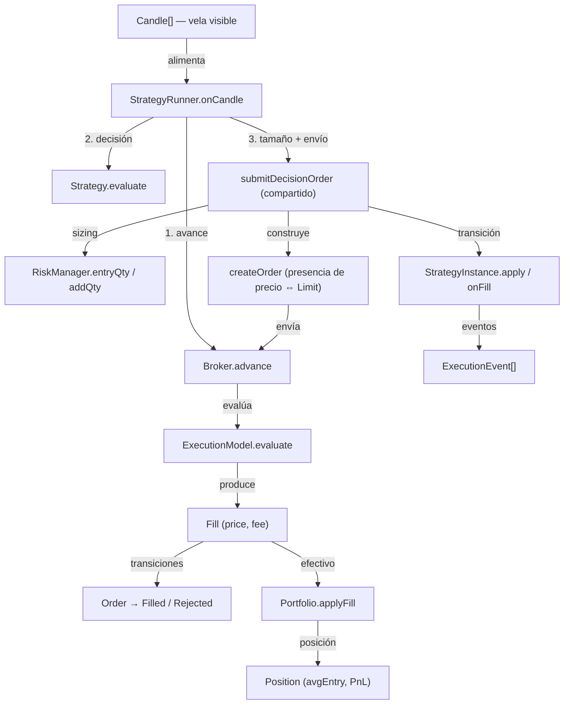
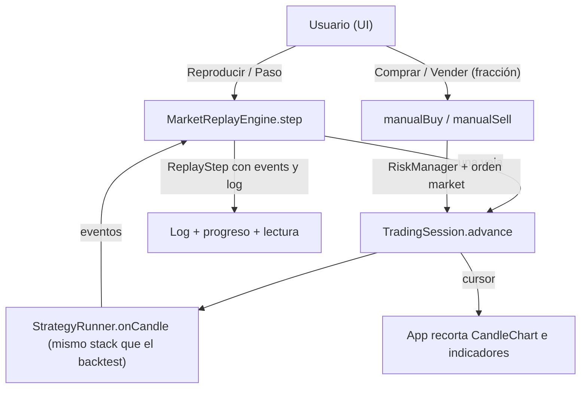
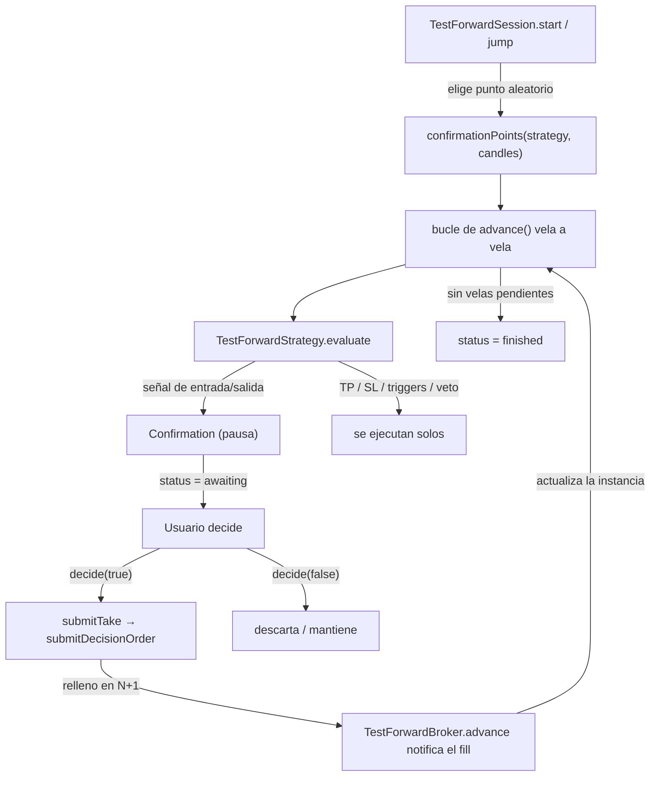

# Diagrama de clases del dominio

> Diagramas Mermaid de `src/` (`domain/` + `storage/`) — fuente de verdad de la estructura del
> código. Cubre el estado actual tras las **Fases 3 (Ejecución simulada), 4 (Backtesting),
> 5 (Simulación interactiva) y 6 (Experimentación avanzada)**, el **plan de editor de
> estrategias + test-forward interactivo** (2026-11-14) y la **tanda de refactors del dominio**
> (2026-11-16: split de `spec/`, `Trade`/`RecordingBroker` → `execution/`, primitiva de envío
> compartida). Requisitos: [`architecture.md`](./architecture.md).
>
> ⚠️ **Este documento debe actualizarse siempre que cambie el código que representa**: añadir o
> mover paquetes/clases, crear o eliminar errores, o cambiar dependencias entre paquetes. Ver
> «Documentación y diagramas» en `AGENTS.md`.
>
> **Todos los diagramas están organizados de arriba abajo como árboles jerárquicos** (`direction TB` /
> `flowchart TB`): raíz arriba, subsistemas debajo, tipos hoja al final. El diagrama de paquetes
> muestra además las dependencias **entre** paquetes con flechas discontinuas (de quien importa a
> quien se importa), que se detallan en su tabla; el flujo de ejecución va en árbol (sección 4).
>
> Cobertura: `src/domain/**` y `src/storage/**`. `src/api/**` (proveedor Binance) queda fuera del
> alcance de estos diagramas; solo se menciona en la jerarquía de errores.

## 1. Diagrama de paquetes

Mermaid no incluye `packageDiagram` (es de PlantUML); se representa con `flowchart TB` + `subgraph`:
raíz `src/domain/` — **11 subcarpetas + 3 módulos raíz** (`errors.ts`, `numbers.ts`, `guards.ts`) →
tipos de cada paquete — y `src/storage/` (adaptador de persistencia).

```mermaid
flowchart TB
    Domain["src/domain/"]

    subgraph errors["errors.ts (raíz)"]
        DomainError["DomainError (abstracto)"]
        DomainErrors["27 errores Invalid*Error / *Error"]
    end

    subgraph numbers["numbers.ts (raíz, hoja)"]
        IsUnitFraction["isUnitFraction(value)"]
    end

    subgraph guards["guards.ts (raíz, hoja)"]
        Guards["isRecord / isFiniteNumber / isPositiveNumber"]
    end

    subgraph candles["candles/"]
        Candle["Candle (VO OHLCV)"]
        Timeframe["Timeframe (internado)"]
        PricePosition["PricePosition"]
        LevelPosition["LevelPosition"]
        CsvImporter["CsvCandlesImporter"]
    end

    subgraph instruments["instruments/"]
        Instrument["Instrument (internado)"]
    end

    subgraph indicators["indicators/"]
        Indicator["Indicator (interface)"]
        IndicatorValue["IndicatorValue"]
        Sma["Sma"]
        Ema["Ema"]
        Rsi["Rsi"]
        LowestLow["LowestLow"]
        Constant["Constant"]
    end

    subgraph strategies["strategies/"]
        Spec["spec/ (types · validate · build · aliases)"]
        PriceExprType["PriceExpr / PriceSeriesRef"]
        MarketContext["MarketContext"]
        OperationLevelsT["OperationLevels"]
        Rule["Rule (interface)"]
        Crosses["Crosses / Comparison / Logical / Not"]
        Signal["Signal / SignalConfig"]
        Trigger["Trigger / PriceLevel"]
        Strategy["Strategy"]
        StrategyInstance["StrategyInstance"]
        StrategyAction["StrategyAction"]
        StrategyState["StrategyState"]
        StrategyDecision["StrategyDecision"]
        StrategyTransition["StrategyTransition"]
        StrategyEvent["StrategyEvent"]
    end

    subgraph execution["execution/"]
        Order["Order"]
        OrderSpecT["OrderSpec"]
        OrderSide["OrderSide"]
        OrderType["OrderType"]
        OrderStatus["OrderStatus"]
        Fill["Fill"]
        ExecutionModel["ExecutionModel (interface)"]
        NextOpen["NextOpenExecutionModel"]
        Position["Position"]
        Broker["Broker (interface)"]
        Account["Account (puerto)"]
        HistoricalBroker["HistoricalBroker"]
        RecordingBroker["RecordingBroker"]
        Trade["Trade"]
    end

    subgraph portfolio["portfolio/"]
        Portfolio["Portfolio"]
        RiskManager["RiskManager"]
        RiskConfig["RiskConfig"]
    end

    subgraph trading["trading/"]
        StrategyRunner["StrategyRunner"]
        ExecutionEvent["ExecutionEvent"]
        DecisionOrderT["DecisionOrderRequest / Submission"]
        TradingSession["TradingSession (motor compartido §7)"]
        CandleStep["CandleStep"]
        LogFormat["logFormat (textos de log §12D)"]
    end

    subgraph time["time/"]
        MarketClock["MarketClock"]
    end

    subgraph backtest["backtest/"]
        Metrics["Metrics / EquityPoint"]
        BacktestResult["BacktestResult"]
        Experiment["Experiment"]
        ExperimentSnapshot["ExperimentSnapshot"]
        RunBacktest["runBacktest()"]
        CompareTypes["ComparisonRow / ComparisonTable"]
        CompareFns["compareExperiments() / rankBy()"]
        OptimizeTypes["OptimizationConfig / OptimizationResult / RobustnessReport"]
        OptimizeFns["runOptimization() / analyzeRobustness()"]
    end

    subgraph replay["replay/"]
        MarketReplayEngine["MarketReplayEngine"]
        ReplayStep["ReplayStep"]
        ReplayLogEntry["ReplayLogEntry"]
        ReplayStatus["ReplayStatus"]
        ReplayLog["ReplayLog (interno)"]
        ReplayError["ReplayError"]
        ReplaySpeed["replayIntervalMs()"]
    end

    subgraph testforward["testforward/"]
        TestForwardSession["TestForwardSession"]
        TestForwardBroker["TestForwardBroker"]
        TestForwardError["TestForwardError"]
        ConfirmationT["Confirmation / ConfirmationKind"]
        ConfirmationPoints["confirmationPoints()"]
    end

    subgraph storage["storage/"]
        CandleRepository["CandleRepository"]
        ExperimentRepository["ExperimentRepository"]
        StrategyRepository["StrategyRepository"]
        CorruptedStorage["CorruptedStorageError"]
        SidebarState["loadOpenSection / saveOpenSection"]
    end

    Storage["src/storage/"]

    Domain --> errors
    Domain --> numbers
    Domain --> guards
    Domain --> candles
    Domain --> instruments
    Domain --> indicators
    Domain --> strategies
    Domain --> execution
    Domain --> portfolio
    Domain --> trading
    Domain --> time
    Domain --> backtest
    Domain --> replay
    Domain --> testforward
    Storage --> storage

    %% dependencias entre paquetes (quién importa de quién): discontinua
    candles -.-> errors
    instruments -.-> errors
    indicators -.-> candles
    indicators -.-> errors
    strategies -.-> candles
    strategies -.-> indicators
    strategies -.-> errors
    strategies -.-> numbers
    strategies -.-> guards
    execution -.-> candles
    execution -.-> errors
    portfolio -.-> execution
    portfolio -.-> errors
    portfolio -.-> numbers
    trading -.-> candles
    trading -.-> strategies
    trading -.-> execution
    trading -.-> portfolio
    trading -.-> time
    trading -.-> errors
    time -.-> errors
    backtest -.-> candles
    backtest -.-> strategies
    backtest -.-> execution
    backtest -.-> instruments
    backtest -.-> portfolio
    backtest -.-> trading
    backtest -.-> errors
    replay -.-> trading
    replay -.-> execution
    replay -.-> candles
    replay -.-> numbers
    replay -.-> errors
    testforward -.-> trading
    testforward -.-> strategies
    testforward -.-> execution
    testforward -.-> candles
    testforward -.-> errors
    storage -.-> candles
    storage -.-> instruments
    storage -.-> execution
    storage -.-> strategies
    storage -.-> backtest
    storage -.-> errors
    storage -.-> guards
```



- **Sólida** `──►` = pertenencia (raíz `src/domain/` o `src/storage/` → paquete).
- **Discontinua** `- -►` = dependencia de importación (paquete → paquete del que importa).
- Capas que emergen de arriba abajo: `replay`/`testforward` → `trading` → `strategies`/`portfolio` →
  `execution`/`indicators` → `candles`/`instruments`/`time` → `errors`, `numbers` y `guards` (tres
  hojas raíz, abajo del todo); `storage` es la capa de adaptadores por encima de
  `candles`/`instruments`/`execution`/`strategies`/`backtest`.
- **Sin ciclos**: `execution` **no** importa de `portfolio` gracias al puerto
  `Account` (`src/domain/execution/account.ts`): `HistoricalBroker` depende de la interfaz y
  `Portfolio` la implementa (`portfolio → execution`, un solo sentido). Tampoco hay ciclo
  `backtest ↔ trading`: `TradingSession` recibe el broker como **decorador inyectado**
  (`decorateBroker`, Fase 5) en vez de construir `RecordingBroker`, de modo que `trading` nunca
  importa de `backtest`.
- **`replay` y `testforward` ya no dependen de `backtest`** (refactor 2026-11-16): `Trade` y
  `RecordingBroker` se movieron a `execution/`, de modo que el decorador de observabilidad vive en
  la capa de ejecución y ambos consumidores lo importan sin subir a `backtest`.
- **`numbers.ts` es una hoja sin imports** (`isUnitFraction`): la comparten `strategies`,
  `portfolio` y `replay` sin que `portfolio` tenga que depender de `strategies`.
- **`guards.ts` es una hoja sin imports** (predicados de forma `isRecord`, `isFiniteNumber`,
  `isPositiveNumber`): la comparten `strategies` y `storage`; unifica las copias idénticas de
  `isRecord` que vivían en `marketContext.ts`, `priceExpr.ts`, `spec/validate.ts` y
  `experimentRepository.ts` (refactor 2026-11-16).

### Detalle de las dependencias (las mismas flechas discontinuas del diagrama)

| Paquete       | Importa de                                                                            | Nota                                                                                                  |
| ------------- | ------------------------------------------------------------------------------------- | ----------------------------------------------------------------------------------------------------- |
| `errors`      | —                                                                                     | raíz de la jerarquía de errores                                                                       |
| `numbers`     | —                                                                                     | hoja: `isUnitFraction` compartida sin invertir dependencias                                           |
| `guards`      | —                                                                                     | hoja: predicados de forma (`isRecord`, `isFiniteNumber`, `isPositiveNumber`) compartidos              |
| `candles`     | `errors`                                                                              |                                                                                                       |
| `instruments` | `errors`                                                                              |                                                                                                       |
| `indicators`  | `candles`, `errors`                                                                   | `Sma`/`Ema`/`Rsi`/`LowestLow`/`Constant`                                                              |
| `strategies`  | `candles`, `indicators`, `errors`, `numbers`, `guards`                                | incluye `spec/` (tipos + validate + build + aliases) y `priceExpr.ts`                                 |
| `execution`   | `candles`, `errors`                                                                   | usa el puerto `Account` (sin dependencia de `portfolio`); contiene `Trade` y `RecordingBroker`        |
| `portfolio`   | `execution`, `errors`, `numbers`                                                      | `Position`/`Fill`/`OrderSide` de `execution`                                                          |
| `trading`     | `candles`, `strategies`, `execution`, `portfolio`, `time`, `errors`                   | `StrategyRunner` + `TradingSession` (motor común vela a vela, §7) + `logFormat`                       |
| `time`        | `errors`                                                                              | tiempo de simulación (§12A)                                                                           |
| `backtest`    | `candles`, `strategies`, `execution`, `instruments`, `portfolio`, `trading`, `errors` | motor + `Experiment` (§7/§9); consume `TradingSession` en `runBacktest`                               |
| `replay`      | `trading`, `execution`, `candles`, `numbers`, `errors`                                | replay interactivo (§7B): envuelve `TradingSession` con `RecordingBroker`                             |
| `testforward` | `trading`, `strategies`, `execution`, `candles`, `errors`                             | test-forward interactivo (§2): envuelve `TradingSession` con `TestForwardBroker`                      |
| `storage`     | `candles`, `instruments`, `execution`, `strategies`, `backtest`, `errors`, `guards`   | adaptadores con `Storage` inyectado: `CandleRepository`, `ExperimentRepository`, `StrategyRepository` |

> El ciclo histórico `execution ↔ portfolio` se resolvió con el puerto `Account`
> (`src/domain/execution/account.ts`): `HistoricalBroker` depende de la interfaz y `Portfolio` la
> implementa, así que la dependencia queda en un solo sentido `portfolio → execution`.
> `backtest` **ya no importa de `time`** (`Timeframe` vive en `candles/`, no en `time/`).

## 2. Diagrama de clases

Jerarquía de arriba abajo: herencia (`<|--`) de padre a hijos, composición dentro de cada paquete y
solo las asociaciones de objeto entre subsistemas (el grafo fino de tipos ya se ve en los miembros).

```mermaid
classDiagram
    direction TB

    namespace candles {
        class Candle {
            <<valueObject>>
            +time: number
            +open: number
            +high: number
            +low: number
            +close: number
            +volume: number
            +from(value) Candle
            +positionOf(price) PricePosition
        }
        class Timeframe {
            <<interned>>
            +code: TimeframeCode
            +ms: number
            +from(value) Timeframe
            +equals(other: Timeframe) boolean
        }
        class PricePosition {
            <<enumeration>>
            Above
            UpperWick
            Body
            LowerWick
            Below
        }
        class LevelPosition {
            <<enumeration>>
            Above
            At
            Below
        }
        class CsvCandlesImporter {
            +parse(text: string) Candle[]
            +parseRow(row: string) Candle
            +detectDelimiter(text: string) CsvDelimiter
        }
    }

    namespace instruments {
        class Instrument {
            <<interned>>
            +base: string
            +quote: string
            +from(value) Instrument
            +of(base, quote) Instrument
            +exchangeSymbol: string
            +equals(other: Instrument) boolean
        }
    }

    namespace indicators {
        class IndicatorValue {
            +time: number
            +value: number
        }
        class Indicator {
            <<interface>>
            +name: string
            +calculate(candles: Candle[]) IndicatorValue[]
        }
        class Sma {
            +period: number
            +calculate(candles: Candle[]) IndicatorValue[]
        }
        class Ema {
            +period: number
            +calculate(candles: Candle[]) IndicatorValue[]
        }
        class Rsi {
            +period: number
            +calculate(candles: Candle[]) IndicatorValue[]
        }
        class LowestLow {
            +period: number
            +calculate(candles: Candle[]) IndicatorValue[]
        }
        class Constant {
            +value: number
            +calculate(candles: Candle[]) IndicatorValue[]
        }
    }

    namespace strategies {
        class PriceExpr {
            <<union>>
            series with id
            binary op left right
        }
        class OperationLevels {
            <<interface>>
            +entry: number
            +sl: number
            +tp: number
        }
        class MarketContext {
            <<inmutable>>
            -visibleCandles: Candle[]
            -series: Record
            -levelsValue: OperationLevels
            -base: number
            +from(data) MarketContext
            +time: number
            +current: Candle
            +previous: Candle
            +length: number
            +candles: Candle[]
            +levels: OperationLevels
            +withLevels(levels) MarketContext
            +at(back: number) MarketContext
            +value(id: string, back: number) number
        }
        class Rule {
            <<interface>>
            +name: string
            +evaluate(context: MarketContext) boolean
        }
        class Crosses {
            +a: SeriesRef
            +b: SeriesRef
            -direction: string
            +evaluate(context: MarketContext) boolean
        }
        class CrossesAbove
        class CrossesBelow
        class Comparison {
            +a: SeriesRef
            +b: SeriesRef
            -op: string
            +evaluate(context: MarketContext) boolean
        }
        class Greater
        class Lower
        class Logical {
            +rules: Rule[]
            -mode: string
            +evaluate(context: MarketContext) boolean
        }
        class All
        class Any
        class Not {
            +rule: Rule
            +evaluate(context: MarketContext) boolean
        }
        class Signal {
            +name: string
            +action: SignalAction
            +rule: Rule
            +config: SignalConfig
        }
        class SignalConfig {
            +fraction: number
            +price: PriceExpr
        }
        class PriceLevel {
            +price: PriceExpr
            +execution: OrderExecution
        }
        class Trigger {
            +price: PriceExpr
            +action: SignalAction
            +execution: OrderExecution
            +fraction: number
            +name: string
        }
        class Strategy {
            +name: string
            +version: number
            +indicators: Record
            +signals: Signal[]
            +invalidationRule: Rule
            +takeProfit: PriceLevel
            +stopLoss: PriceLevel
            +triggers: Trigger[]
            +buildContext(candles, levels) MarketContext
            +evaluate(context: MarketContext, open: boolean) StrategyDecision
            +toString() string
        }
        class StrategyDecision {
            <<interface>>
            +action: StrategyAction
            +fraction: number
            +price: number
            +reason: string
        }
        class StrategyAction {
            <<enumeration>>
            None
            RequestEntry
            RequestAdd
            RequestReduce
            RequestExit
            Invalidate
        }
        class StrategyState {
            <<enumeration>>
            WaitingForSignal
            WaitingForEntryFill
            WaitingForExitSignal
            WaitingForExitFill
        }
        class StrategyEvent {
            <<union>>
            StrategyConfirmed
            EntryCancelled
            PositionOpened
            ExitRequested
            PositionClosed
        }
        class StrategyTransition {
            <<interface>>
            +from: StrategyState
            +to: StrategyState
            +changed: boolean
            +event: StrategyEvent
        }
        class StrategyInstance {
            +strategy: Strategy
            -current: StrategyState
            +state: StrategyState
            +open: boolean
            +entryPending: boolean
            +apply(decision: StrategyDecision) StrategyTransition
            +onFill() StrategyTransition
        }
    }

    namespace execution {
        class Order {
            +id: string
            +side: OrderSide
            +type: OrderType
            +qty: number
            +price: number
            +createdAt: number
            +rejectReason: string
            +status: OrderStatus
            +isPending: boolean
            +fill()
            +cancel()
            +reject(reason: string)
        }
        class OrderSpec {
            <<interface>>
            +id: string
            +side: OrderSide
            +price: number
            +qty: number
            +createdAt: number
        }
        class createOrder {
            <<function>>
            +createOrder(spec: OrderSpec) Order
        }
        class OrderSide {
            <<enumeration>>
            Buy
            Sell
        }
        class OrderType {
            <<enumeration>>
            Market
            Limit
        }
        class OrderStatus {
            <<enumeration>>
            Pending
            Filled
            Cancelled
            Rejected
        }
        class Fill {
            +orderId: string
            +side: OrderSide
            +price: number
            +qty: number
            +fee: number
            +time: number
        }
        class ExecutionModel {
            <<interface>>
            +evaluate(order: Order, candle: Candle) Fill
        }
        class NextOpenExecutionModel {
            +slippageBps: number
            +feeBps: number
            +evaluate(order: Order, candle: Candle) Fill
        }
        class Position {
            +openedAt: number
            -qtyValue: number
            -entryPrice: number
            -realized: number
            -fees: number
            +qty: number
            +avgEntryPrice: number
            +realizedPnl: number
            +feesPaid: number
            +isOpen: boolean
            +isEmpty: boolean
            +from(fill: Fill) Position
            +applyFill(fill: Fill)
            +realizedPnlFor(fill: Fill) number
            +marketValue(price: number) number
            +unrealizedPnl(price: number) number
        }
        class Account {
            <<interface>>
            +cash: number
            +position: Position
            +applyFill(fill: Fill)
        }
        class Broker {
            <<interface>>
            +submitOrder(order: Order) Order
            +cancelOrder(orderId: string)
            +advance(candle: Candle) Fill[]
            +positions() Position[]
            +pendingOrders() Order[]
        }
        class HistoricalBroker {
            +account: Account
            +executionModel: ExecutionModel
            -pending: Order[]
            +submitOrder(order: Order) Order
            +cancelOrder(orderId: string)
            +advance(candle: Candle) Fill[]
            +positions() Position[]
            +pendingOrders() Order[]
        }
        class RecordingBroker {
            +inner: Broker
            +account: Account
            -tradeLog: Trade[]
            -orderLog: Order[]
            -fillLog: Fill[]
            +trades: Trade[]
            +orders: Order[]
            +fills: Fill[]
            +submitOrder(order: Order) Order
            +advance(candle: Candle) Fill[]
            +submitExternalFill(order: Order, fill: Fill)
        }
        class Trade {
            +entryTime: number
            +entryPrice: number
            +exitTime: number
            +exitPrice: number
            +qty: number
            +pnl: number
            +fees: number
            +win: boolean
            +durationMs: number
            +toJSON() TradeData
            +from(data) Trade
        }
    }

    namespace portfolio {
        class Portfolio {
            +initialCapital: number
            -cashValue: number
            -positionValue: Position
            -closedRealized: number
            -fees: number
            +cash: number
            +position: Position
            +realizedPnl: number
            +feesPaid: number
            +exposure(price: number) number
            +equity(price: number) number
            +applyFill(fill: Fill)
        }
        class RiskConfig {
            <<interface>>
            +maxPositionFraction: number
            +minCashReserve: number
            +feeBps: number
            +slippageBps: number
        }
        class RiskManager {
            +maxPositionFraction: number
            +minCashReserve: number
            +feeBps: number
            +slippageBps: number
            +entryQty(portfolio: Portfolio, price: number) number
            +addQty(portfolio: Portfolio, price: number, fraction: number) number
            +canAdd(portfolio: Portfolio, price: number, qty: number) boolean
        }
    }

    namespace trading {
        class StrategyRunner {
            +strategy: Strategy
            +instance: StrategyInstance
            +broker: Broker
            +portfolio: Portfolio
            +risk: RiskManager
            +clock: MarketClock
            -pendingOrder: Order
            -pendingKind: string
            -orderSeq: number
            +onCandle(candles: Candle[]) ExecutionEvent[]
            +submitDecisionOrder(request: DecisionOrderRequest) DecisionOrderSubmission
        }
        class ExecutionEvent {
            <<union>>
            StrategyEvent
            OrderSubmitted
            OrderFilled
            OrderRejected
            OrderCancelled
        }
        class DecisionOrderRequest {
            <<interface>>
            +decision: StrategyDecision
            +kind: string
            +referencePrice: number
            +time: number
            +nextId: function
        }
        class DecisionOrderSubmission {
            <<interface>>
            +order: Order
            +transition: StrategyTransition
        }
        class TradingSession {
            +candles: Candle[]
            +timeframe: Timeframe
            +portfolio: Portfolio
            +riskManager: RiskManager
            +clock: MarketClock
            +instance: StrategyInstance
            +broker: Broker
            +executionConfig: object
            +riskConfig: object
            +cursor: number
            +finished: boolean
            +position: Position
            +events: ExecutionEvent[]
            +pendingOrderCount() number
            +addQty(fraction: number) number
            +referencePrice() number
            +referenceTime() number
            +submitOrder(spec) Order
            +cancelOrder(orderId: string)
            +submitDecisionOrder(request) DecisionOrderSubmission
            +advance() CandleStep
        }
        class CandleStep {
            <<interface>>
            +index: number
            +candle: Candle
            +events: ExecutionEvent[]
            +equity: number
        }
    }

    namespace time {
        class MarketClock {
            -current: number
            +now: number
            +advanceTo(time: number)
        }
    }

    namespace backtest {
        class Metrics {
            <<interface>>
            +netProfit: number
            +roi: number
            +maxDrawdown: number
            +sharpe: number
            +profitFactor: number
            +winRate: number
            +avgTrade: number
            +expectancy: number
        }
        class EquityPoint {
            <<interface>>
            +time: number
            +equity: number
        }
        class BacktestResult {
            <<interface>>
            +trades: Trade[]
            +equityCurve: EquityPoint[]
            +metrics: Metrics
            +finalEquity: number
            +orders: Order[]
            +events: ExecutionEvent[]
            +execution: object
            +risk: object
        }
        class Experiment {
            +strategyId: string
            +fingerprint: string
            +instrument: Instrument
            +timeframe: Timeframe
            +period: object
            +initialCapital: number
            +execution: object
            +risk: object
            +result: BacktestResult
            +run(config) Experiment
            +toSnapshot() ExperimentSnapshot
        }
        class ExperimentSnapshot {
            <<interface>>
            +id: string
            +strategyId: string
            +fingerprint: string
            +instrument: string
            +timeframe: string
            +period: object
            +initialCapital: number
            +execution: object
            +risk: object
            +metrics: Metrics
            +finalEquity: number
            +equityCurve: EquityPoint[]
            +trades: Trade[]
        }
        class runBacktest {
            <<function>>
            +runBacktest(config) BacktestResult
        }
        class ComparisonRow {
            <<interface>>
            +id: string
            +strategyId: string
            +instrument: string
            +timeframe: string
            +period: object
            +initialCapital: number
            +metrics: Metrics
            +finalEquity: number
        }
        class ComparisonTable {
            <<interface>>
            +rows: ComparisonRow[]
            +differences: ComparisonField[]
        }
        class compareExperiments {
            <<function>>
            +compareExperiments(snapshots) ComparisonTable
            +rankBy(rows, metric) ComparisonRow[]
        }
        class OptimizationConfig {
            <<interface>>
            +buildStrategy: StrategyFactory
            +grid: object
            +metric: keyof Metrics
            +base: object
        }
        class OptimizationRun {
            <<interface>>
            +params: object
            +metrics: Metrics
            +finalEquity: number
            +tradeCount: number
        }
        class OptimizationResult {
            <<interface>>
            +grid: object
            +metric: keyof Metrics
            +runs: OptimizationRun[]
            +best: OptimizationRun
            +worst: OptimizationRun
        }
        class runOptimization {
            <<function>>
            +MAX_OPTIMIZATION_RUNS: number
            +runOptimization(config) OptimizationResult
        }
        class OptimizationError {
            +name: string
        }
        class RobustnessReport {
            <<interface>>
            +metric: keyof Metrics
            +count: number
            +best: number
            +worst: number
            +mean: number
            +stdev: number
            +plateau: object
            +aboveThreshold: object
            +sensitivity: SensitivityEntry[]
        }
        class SensitivityEntry {
            <<interface>>
            +param: string
            +spread: number
        }
        class analyzeRobustness {
            <<function>>
            +analyzeRobustness(result, options) RobustnessReport
        }
        class RobustnessError {
            +name: string
        }
    }

    namespace replay {
        class MarketReplayEngine {
            +session: TradingSession
            +status: ReplayStatus
            +cursor: number
            +log: ReplayLogEntry[]
            +play()
            +pause()
            +step() ReplayStep
            +reset()
            +manualBuy(fraction: number) Order
            +manualSell(fraction: number) Order
        }
        class ReplayLog {
            -entries: ReplayLogEntry[]
            +snapshot() ReplayLogEntry[]
            +slice(fromIndex: number) ReplayLogEntry[]
            +reset()
            +noteManualOrder(order: Order, time: number)
            +appendStep(orders, fills, events, time)
        }
        class ReplayStatus {
            <<union>>
            ready
            playing
            finished
        }
        class ReplayStep {
            <<interface>>
            +index: number
            +time: number
            +status: ReplayStatus
            +events: ExecutionEvent[]
            +log: ReplayLogEntry[]
        }
        class ReplayLogEntry {
            <<interface>>
            +time: number
            +kind: ReplayLogKind
            +text: string
            +orderId: string
        }
        class ReplayError {
            +name: string
        }
        class replayIntervalMs {
            <<function>>
            +replayIntervalMs(timeframe: Timeframe, speed: number) number
        }
    }

    namespace testforward {
        class TestForwardSession {
            +session: TradingSession
            +status: TestForwardStatus
            +cursor: number
            +confirmation: Confirmation
            +points: number[]
            +strategy: Strategy
            +levelOverrides: object
            +log: TestForwardLogEntry[]
            +start()
            +decide(take: boolean)
            +step()
            +jump()
            +reset()
            +setTakeProfit(price: number, enabled: boolean)
            +setStopLoss(price: number, enabled: boolean)
        }
        class TestForwardBroker {
            +onFillHook: function
            +advance(candle: Candle) Fill[]
        }
        class TestForwardStrategy {
            -confirmationValue: Confirmation
            -slOverride: number
            -tpOverride: number
            -entryBlocked: boolean
            -exitBlocked: boolean
            +confirmation: Confirmation
            +levelOverrides: object
            +setLevelOverride(kind, value)
            +blockOwnOrder(kind: ConfirmationKind)
            +releaseOwnOrder(kind: ConfirmationKind)
            +releaseOwnOrders()
            +evaluate(context: MarketContext, open: boolean) StrategyDecision
        }
        class Confirmation {
            <<interface>>
            +kind: ConfirmationKind
            +decision: StrategyDecision
        }
        class TestForwardStatus {
            <<union>>
            idle
            awaiting
            finished
        }
        class TestForwardError {
            +name: string
        }
        class confirmationPoints {
            <<function>>
            +confirmationPoints(strategy: Strategy, candles: Candle[]) number[]
        }
    }
    namespace storage {
        class CandleRepository {
            +save(instrument, timeframe, candles)
            +find(instrument, timeframe, range) Candle[]
            +count(instrument, timeframe) number
            +remove(instrument, timeframe) boolean
            +listInstruments() Instrument[]
            +listTimeframes(instrument) Timeframe[]
            +clear()
        }
        class ExperimentRepository {
            +save(snapshot)
            +find(id) ExperimentSnapshot
            +list() ExperimentSnapshot[]
            +remove(id) boolean
            +clear()
        }
        class StrategyRepository {
            +save(spec: StrategySpec) string
            +nextVersion(name: string) number
            +find(id: string) StrategySnapshot
            +list() StrategySnapshot[]
            +corruptedKeys() string[]
            +repair() string[]
            +remove(id: string) boolean
            +clear()
        }
        class CorruptedStorageError {
            +name: string
        }
    }

    %% ---- herencia (árboles) ----
    Indicator <|.. Sma
    Indicator <|.. Ema
    Indicator <|.. Rsi
    Indicator <|.. LowestLow
    Indicator <|.. Constant
    Rule <|.. Crosses
    Rule <|.. Comparison
    Rule <|.. Logical
    Rule <|.. Not
    Crosses <|-- CrossesAbove
    Crosses <|-- CrossesBelow
    Comparison <|-- Greater
    Comparison <|-- Lower
    Logical <|-- All
    Logical <|-- Any
    HistoricalBroker ..|> Broker : implementa
    RecordingBroker ..|> Broker : implementa
    RecordingBroker <|-- TestForwardBroker
    Portfolio ..|> Account : implements
    Strategy <|-- TestForwardStrategy

    %% ---- composición por subsistema ----
    MarketContext --> Candle : velas visibles
    MarketContext --> OperationLevels : niveles entry sl tp
    Logical --> Rule : AND / OR
    Not --> Rule : negada
    Signal --> Rule : condición
    SignalConfig ..> PriceExpr : precio limit opcional
    Trigger --> PriceExpr : precio del disparador
    Strategy --> Signal : señales priorizadas
    Strategy --> Indicator : indicadores declarados
    Strategy --> Trigger : triggers por toque
    Strategy ..> MarketContext : buildContext
    Strategy ..> StrategyDecision : evaluate
    StrategyInstance --> Strategy
    Position --> Fill
    Portfolio --> Position
    RiskManager ..> RiskConfig
    createOrder ..> OrderSpec : construye
    RecordingBroker --> Account
    RecordingBroker ..> Trade : registra cierres
    RecordingBroker ..> Order : registra ordenes
    Experiment ..> BacktestResult : resultado
    Experiment ..> runBacktest : ejecuta
    runBacktest ..> BacktestResult : produce
    BacktestResult --> Metrics
    BacktestResult --> Trade

    %% ---- grafo de objetos entre subsistemas ----
    HistoricalBroker ..> Account : puerto (sin ciclo)
    HistoricalBroker --> ExecutionModel : modelo inyectado
    StrategyRunner --> Strategy
    StrategyRunner --> StrategyInstance
    StrategyRunner --> Broker
    StrategyRunner --> Portfolio
    StrategyRunner --> RiskManager
    StrategyRunner --> MarketClock : tiempo de simulacion (12A)
    StrategyRunner ..> DecisionOrderSubmission : primitiva de envio compartida
    TradingSession --> StrategyRunner : onCandle por vela
    TradingSession --> Portfolio
    TradingSession --> RiskManager
    TradingSession --> MarketClock : tiempo de simulacion (12A)
    TradingSession ..> Broker : decorado (decorateBroker, sin ciclo)
    TradingSession ..> Order : submitOrder manuales
    runBacktest ..> TradingSession : motor compartido (7)
    MarketReplayEngine --> TradingSession : motor compartido (7)
    MarketReplayEngine ..> ReplayStep : devuelve por vela
    MarketReplayEngine ..> ReplayLogEntry : log (12D)
    ReplayLog ..> ReplayLogEntry : append-only
    replayIntervalMs ..> Timeframe : intervalo en tiempo real (7B)
    TestForwardSession --> TradingSession : motor compartido (7)
    TestForwardSession --> Confirmation : pausa a decidir
    TestForwardStrategy ..> Confirmation : produce la confirmacion (2.1)
    TestForwardSession ..> TestForwardBroker : decorador con hook de fill
    TestForwardBroker ..> Fill : notifica rellenos a la sesion
    confirmationPoints ..> Strategy : puntos de confirmacion (2.2)
    Experiment ..> ExperimentSnapshot : toSnapshot (Fase 6)
    ExperimentSnapshot ..> Trade : roundtrip toJSON / from
    compareExperiments ..> ExperimentSnapshot : filas comparadas (9)
    runOptimization ..> runBacktest : un backtest por combinacion (13)
    analyzeRobustness ..> OptimizationResult : informe de robustez (13)
    ExperimentRepository ..> ExperimentSnapshot : persiste (Storage)
    ExperimentRepository ..> Trade : reconstruye con Trade.from
    StrategyRepository ..> StrategySpec : persiste la spec (Storage)
    CandleRepository ..> Candle : persiste (Storage)
```

> `TestForwardStrategy` (interna de `testforward/session.ts`, no exportada) extiende `Strategy` para
> inyectar los overrides de TP/SL de la sesión y **suprimir** las señales de entrada/salida
> convirtiéndolas en `Confirmation` que decide el usuario (§2.1). Se dibuja aquí por su relación de
> herencia, aunque su clase vive en el módulo `testforward`.

## 3. Jerarquía de errores

Hay **27 clases de error en `src/domain/`**, todas extienden `DomainError`
(`src/domain/errors.ts`), fijan `this.name` y formatean el mensaje con
`invalidMessage(prefix, reason, raw)` (`"… (recibido: <valor>)"`). Dos errores adicionales extienden
`DomainError` pero viven **fuera** del dominio y se muestran aparte.

```mermaid
classDiagram
    direction TB
    class DomainError {
        <<abstract>>
        +name: string
        +message: string
    }

    class InvalidCandlesError
    class InvalidTimeframeError
    class InvalidCsvError
    class InvalidPriceError
    class InvalidInstrumentError
    class InvalidPeriodError
    class InvalidConstantError
    class InvalidPriceExprError
    class MarketContextError
    class InvalidStrategyDefinitionError
    class InvalidStrategyTransitionError
    class InvalidOrderError
    class InvalidFillError
    class InvalidPositionError
    class InvalidExecutionModelError
    class InvalidPortfolioError
    class InvalidRiskError
    class TradingSessionError
    class ReplayError
    class TestForwardError
    class MarketClockError
    class InvalidTradeError
    class BacktestError
    class ExperimentError
    class MetricsError
    class OptimizationError
    class RobustnessError

    class MarketDataError
    class CorruptedStorageError

    DomainError <|-- InvalidCandlesError
    DomainError <|-- InvalidTimeframeError
    DomainError <|-- InvalidCsvError
    DomainError <|-- InvalidPriceError
    DomainError <|-- InvalidInstrumentError
    DomainError <|-- InvalidPeriodError
    DomainError <|-- InvalidConstantError
    DomainError <|-- InvalidPriceExprError
    DomainError <|-- MarketContextError
    DomainError <|-- InvalidStrategyDefinitionError
    DomainError <|-- InvalidStrategyTransitionError
    DomainError <|-- InvalidOrderError
    DomainError <|-- InvalidFillError
    DomainError <|-- InvalidPositionError
    DomainError <|-- InvalidExecutionModelError
    DomainError <|-- InvalidPortfolioError
    DomainError <|-- InvalidRiskError
    DomainError <|-- TradingSessionError
    DomainError <|-- ReplayError
    DomainError <|-- TestForwardError
    DomainError <|-- MarketClockError
    DomainError <|-- InvalidTradeError
    DomainError <|-- BacktestError
    DomainError <|-- ExperimentError
    DomainError <|-- MetricsError
    DomainError <|-- OptimizationError
    DomainError <|-- RobustnessError
    DomainError <|-- MarketDataError
    DomainError <|-- CorruptedStorageError
```



Los 27 del dominio, por paquete:

| Paquete       | Errores                                                                                                            |
| ------------- | ------------------------------------------------------------------------------------------------------------------ |
| `candles`     | `InvalidCandlesError`, `InvalidTimeframeError`, `InvalidCsvError`, `InvalidPriceError`                             |
| `instruments` | `InvalidInstrumentError`                                                                                           |
| `indicators`  | `InvalidPeriodError`, `InvalidConstantError`                                                                       |
| `strategies`  | `InvalidPriceExprError`, `MarketContextError`, `InvalidStrategyDefinitionError`, `InvalidStrategyTransitionError`  |
| `execution`   | `InvalidOrderError`, `InvalidFillError`, `InvalidPositionError`, `InvalidExecutionModelError`, `InvalidTradeError` |
| `portfolio`   | `InvalidPortfolioError`, `InvalidRiskError`                                                                        |
| `trading`     | `TradingSessionError`                                                                                              |
| `time`        | `MarketClockError`                                                                                                 |
| `backtest`    | `BacktestError`, `ExperimentError`, `MetricsError`, `OptimizationError`, `RobustnessError`                         |
| `replay`      | `ReplayError`                                                                                                      |
| `testforward` | `TestForwardError`                                                                                                 |

Fuera de `src/domain/`: `MarketDataError` (`src/api/marketDataProvider.ts`, fallos del proveedor de
velas) y `CorruptedStorageError` (`src/storage/errors.ts`, payload corrupto en `Storage`; se
re-exporta desde `candleRepository`).

> **Cambio respecto a versiones anteriores de este documento:** `SplitError` ya **no existe** — el
> test-forward automático por split dev/eval (`splitCandles`, `runTestForward`) se eliminó completo
> al implementar el test-forward interactivo (2026-11-14).

## 4. Flujo de ejecución (árbol de arriba abajo)



**Invariante anti look-ahead:** dentro de `onCandle`, el **1. avance** (rellenos de órdenes previas)
ocurre antes de la **2. decisión** (cierre de la vela actual) y el envío después; una orden decidida
en la vela N solo puede rellenar en N+1 o después.

**Primitiva de envío única (refactor 2026-11-16):** `StrategyRunner.submitDecisionOrder` concentra
sizing, transición de instancia, construcción (`createOrder`) y envío. La usan `submitEntry`/
`submitExit` del propio runner y `TradingSession.submitDecisionOrder`, del que beben los caminos
manuales del replay y las órdenes aceptadas por el usuario en test-forward: misma semántica de
sizing/precio/orden en todos los caminos.

### Ciclo del replay interactivo (Fase 5, §7B)



El motor de reproducción es **uno** (§7): `runBacktest` lo recorre entero de golpe y
`MarketReplayEngine` vela a vela bajo control del usuario; la estrategia no distingue ambos casos
y nunca ve más allá de la vela procesada.

### Ciclo del test-forward interactivo (§2)



La diferencia con el backtest es **quién decide**: el motor es el mismo `TradingSession`, pero las
señales de entrada/salida se convierten en `confirmation` que espera a `decide(take)`, mientras que
TP/SL, triggers y veto se ejecutan solos (§2.1.5).

## 5. Funciones libres y tipos no dibujados

No son clases, pero viven en `src/domain/`:

| Archivo                             | Exporta                                                                                                                                                                                |
| ----------------------------------- | -------------------------------------------------------------------------------------------------------------------------------------------------------------------------------------- |
| `errors.ts`                         | `formatValue(value)`, `invalidMessage(prefix, reason, raw)`                                                                                                                            |
| `numbers.ts`                        | `isUnitFraction(value)` — hoja compartida por `strategies`/`portfolio`/`replay`                                                                                                        |
| `guards.ts`                         | `isRecord(value)`, `isFiniteNumber(value)`, `isPositiveNumber(value)` — predicados de forma compartidos por `strategies` y `storage`                                                   |
| `candles/normalize.ts`              | `normalizeCandles(raw)` — deduplica y ordena                                                                                                                                           |
| `candles/pricePosition.ts`          | `assertFinitePrice(price)`                                                                                                                                                             |
| `indicators/indicator.ts`           | `assertPeriod(period)`, `sortedByTime(candles)`                                                                                                                                        |
| `strategies/rules.ts`               | `resolveRef(context, ref, back)` — alias o constante                                                                                                                                   |
| `strategies/priceExpr.ts`           | `series(id)`, `times(a, b)`, `formatPriceExpr(expr)`, `assertPriceExpr(expr)`, `evaluatePriceExpr(expr, context)`                                                                      |
| `strategies/spec/types.ts`          | formas serializables: `StrategySpec`, `RuleSpec`, `IndicatorSpec`, `EntrySpec`, `TriggerSpec`, `ConditionOp`, `SeriesClass`, `SeriesClasses`, `OperationContext`, `TriggerAction`      |
| `strategies/spec/validate.ts`       | `assertStrategySpec(value)`, `parseStrategySpec(value)`, `assertRuleSpec(value)` — forma → `InvalidStrategyDefinitionError`                                                            |
| `strategies/spec/build.ts`          | `buildStrategy(spec)`, `buildRule(spec, classes)`, `buildIndicator(spec)` — semántica → `Strategy`                                                                                     |
| `strategies/spec/aliases.ts`        | `operationAliases(context)`, `compatibleClasses(a, b)`, `seriesClasses(spec)`, `priceOperandAliases(classes, operations)`, `ruleOperandAliases(...)`, `classOfKind(kind)`              |
| `strategies/fingerprint.ts`         | `canonicalJson(value)`, `strategyFingerprint(strategy)`, `canonicalHash(value)` (§12C)                                                                                                 |
| `execution/costs.ts`                | `withSlippage(price, bps)`, `withFee(price, bps)`, `feeFor(notional, bps)`, `BPS`                                                                                                      |
| `execution/order.ts`                | `createOrder(spec)` — regla de tipo compartida (`null` ⇔ Market)                                                                                                                       |
| `trading/tradingSession.ts`         | `findConfigProblem(config)` — validación compartida (§7)                                                                                                                               |
| `trading/logFormat.ts`              | `formatOrderSent(order)`, `formatManualOrderSent(order)`, `formatFill(fill, manual)`, `formatOrderRejected(...)`, `formatOrderCancelled(id)` (además el helper interno `formatAmount`) |
| `replay/speed.ts`                   | `replayIntervalMs(timeframe, speed)`, `REPLAY_SPEEDS`, `MIN_REPLAY_INTERVAL_MS`, `MAX_REPLAY_INTERVAL_MS`                                                                              |
| `testforward/confirmationPoints.ts` | `confirmationPoints(strategy, candles)` — índices de pausa posibles (§2.2)                                                                                                             |
| `backtest/backtest.ts`              | `runBacktest(config)`                                                                                                                                                                  |
| `backtest/compare.ts`               | `compareExperiments(snapshots)`, `rankBy(rows, metric)` (§9)                                                                                                                           |
| `backtest/metrics.ts`               | `netProfit`, `roi`, `maxDrawdown`, `sharpe`, `profitFactor`, `winRate`, `avgTrade`, `expectancy`, `computeMetrics(input)`, además `sortByMetricDesc(items, metric)`                    |
| `backtest/optimization.ts`          | `runOptimization(config)`, `MAX_OPTIMIZATION_RUNS` (§13)                                                                                                                               |
| `backtest/robustness.ts`            | `analyzeRobustness(result, options)` (§13)                                                                                                                                             |

Tipos (alias/DTO de construcción): `CandleFields`, `TimeframeCode`, `CsvDelimiter`,
`CsvTimestampFormat`, `CsvColumnRef`, `CsvCandlesImporterOptions`, `SeriesRef`, `PriceSeriesRef`,
`PriceExpr`, `PriceLevel`, `OrderExecution`, `SignalAction`, `SignalConfig`, `StrategyDefinition`,
`StrategySpec`, `RuleSpec`, `IndicatorSpec`, `EntrySpec`, `TriggerSpec`, `TriggerAction`,
`ConditionOp`, `SeriesClass`, `SeriesClasses`, `OperationContext`, `OperationLevels`,
`BuiltinField`, `MarketContextData`, `StrategyDecision`, `StrategyEvent`, `StrategyTransition`,
`Indicator`, `IndicatorValue`, `Rule`, `OrderData`, `OrderSpec`, `FillData`, `ExecutionModel`,
`ExecutionModelConfig`, `Account`, `Broker`, `TradeData`, `RiskConfig`, `TradingSessionConfig`, `SessionRiskConfig`, `ConfigProblem`, `BrokerDecorator`,
`CandleStep`, `ExecutionEvent`, `DecisionOrderRequest`, `DecisionOrderSubmission`, `BacktestConfig`,
`BacktestResult`, `Metrics`, `MetricsInput`, `EquityPoint`,
`ExperimentSnapshot`, `ComparisonField`, `ComparisonRow`, `ComparisonTable`, `OptimizationConfig`,
`OptimizationRun`, `OptimizationResult`, `StrategyFactory`, `RobustnessReport`, `SensitivityEntry`,
`ReplayStatus`, `ReplayLogKind`, `ReplayLogEntry`, `ReplayStep`, `TestForwardStatus`,
`ConfirmationKind`, `Confirmation`, `TestForwardLogKind`, `TestForwardLogEntry`.

> **Cambio respecto a versiones anteriores:** `TestForwardConfig` y `TestForwardRun` **ya no
> existen** (eran del test-forward automático por split, eliminado en 2026-11-14) y
> `SignalConfig.limitPrice: SeriesRef` se sustituyó por `SignalConfig.price: PriceExpr`
> (decisión 9: sin precios absolutos).

## 6. Convenciones del diagrama

- **Jerarquía vertical**: todos los diagramas usan `direction TB`/`flowchart TB` — raíz arriba,
  hijos debajo (herencia de padre a hijos, flujo de datos hacia abajo).
- **Visibilidad**: `+` público, `-` privado. Los `getters` se dibujan como campos (`state`, `cash`…).
- **Constructores estáticos** (`from`, `of`, `parse`, `detectDelimiter`) se muestran como métodos
  ordinarios.
- **Valores anulables** se escriben sin `|` (Mermaid no admite pipes en miembros); son `null` cuando
  el código lo indica: `Order.price`, `StrategyDecision.fraction/price/reason`,
  `IndicatorValue.value` (calentamiento), `Portfolio.position`, `Strategy.invalidationRule`,
  `Experiment.instrument`, `RiskManager.entryQty/addQty` y `TradingSession.addQty` (devuelven
  `number | null`), `MarketClock.now` (antes del primer avance), `StrategyRunner.submitDecisionOrder`
  (devuelve `null` si la operación no es admisible) y todos los campos `null`-ables de `Metrics`
  (`sharpe`, `profitFactor`, `winRate`, `avgTrade`, `expectancy` → se muestran como "—").
- `<<union>>` marca tipos de unión (`StrategyEvent`, `ExecutionEvent`, `PriceExpr`, `ReplayStatus`,
  `ReplayLogKind`, `TestForwardStatus`, `ComparisonField`); `<<enumeration>>` enums; `<<interned>>`
  value objects con caché (`Instrument`, `Timeframe`); `<<valueObject>>` VO inmutable;
  `<<function>>` funciones de caso de uso (`runBacktest`, `compareExperiments`/`rankBy`,
  `runOptimization`, `analyzeRobustness`, `createOrder`, `replayIntervalMs`, `confirmationPoints`).
- El diagrama de paquetes distingue **pertenencia** (sólida, raíz → paquete) de **dependencia de
  importación** (discontinua, paquete → paquete); no hay ciclos (el `execution ↔ portfolio` quedó
  eliminado con el puerto `Account` y `replay`/`testforward` dejaron de depender de `backtest` al
  mover `Trade`/`RecordingBroker` a `execution`). La jerarquía de errores va aparte (sección 3).
- Verificado con el parser real de Mermaid (`mermaid.parse`); las etiquetas de arista que contienen
  paréntesis u otros caracteres especiales van entre comillas dobles.
